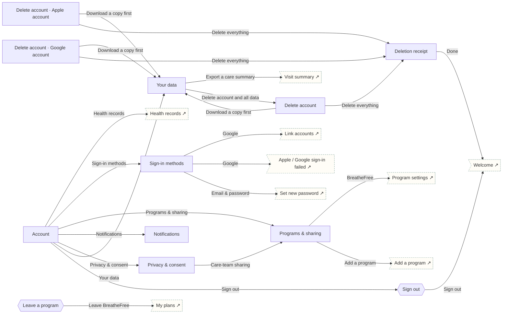

# Account & data

Settings, programs & sharing, notifications, privacy, export, deletion with receipt, sign out.

## Screens

| Screen | Route | Kind / state | Phase |
|---|---|---|---|
| [Account](../screens/png/account/account.png) | `/account` | screen | account |
| [Sign-in methods](../screens/png/account/account_signin_methods.png) | `/account/sign-in` | screen | account |
| [Programs & sharing](../screens/png/account/account_programs.png) | `/account/programs` | screen | account |
| [Leave a program](../screens/png/account/account_leave.png) | `/account/programs/leave` | sheet | account |
| [Notifications](../screens/png/account/account_notifications.png) | `/account/notifications` | screen | account |
| [Privacy & consent](../screens/png/account/account_privacy.png) | `/account/privacy` | screen | account |
| [Your data](../screens/png/account/account_data.png) | `/account/data` | screen | account |
| [Delete account](../screens/png/account/account_delete.png) | `/account/delete` | screen | account |
| [Deletion receipt](../screens/png/account/account_deleted.png) | `/account/deleted` | screen | account |
| [Sign out](../screens/png/account/account_signout.png) | `/account/signout` | sheet | account |
| [Delete account · Apple account](../screens/png/account/account_delete_apple.png) | `/account/delete?state=apple` | screen · Apple account | account |
| [Delete account · Google account](../screens/png/account/account_delete_google.png) | `/account/delete?state=google` | screen · Google account | account |

## Button & action map

| Screen | Element | Action |
|---|---|---|
| Account | Close | `close` |
| Account | Health records | `push → records_hub` |
| Account | Sign-in methods | `push → account_signin_methods` |
| Account | Programs & sharing | `push → account_programs` |
| Account | Notifications | `push → account_notifications` |
| Account | Privacy & consent | `push → account_privacy` |
| Account | Your data | `push → account_data` |
| Account | Text size & contrast | `os_settings` |
| Account | Language | `toast “Language set to English”` |
| Account | Help & legal | `external https://www.tetherhealthgroup.com/support/` |
| Account | Sign out | `sheet → account_signout` |
| Sign-in methods | Back | `back` |
| Sign-in methods | Google | `auth (google): Sign in with Google result → Success: toast “Google connected” | Email already has a Tether account: push → auth_link | Cancelled: toast “Cancelled” | Error: push → auth_social_error` |
| Sign-in methods | Email & password | `push → auth_newpass` |
| Programs & sharing | Back | `back` |
| Programs & sharing | BreatheFree | `push → program_settings` |
| Programs & sharing | ScrollFree | `push → program_settings` |
| Programs & sharing | ClearAir | `push → program_settings` |
| Programs & sharing | Heartwise | `push → program_settings` |
| Programs & sharing | Add a program | `push → catalog` |
| Leave a program | Leave BreatheFree | `DELETE /v1/enrolments/:id then toast “You left BreatheFree” then reset → plans` |
| Leave a program | Cancel | `close` |
| Notifications | Back | `back` |
| Notifications | BreatheFree | `toast “Reminder time saved”` |
| Notifications | ScrollFree | `toast “Reminder time saved”` |
| Notifications | Save | `PATCH /v1/notifications/preferences then toast “Saved” then back` |
| Privacy & consent | Back | `back` |
| Privacy & consent | Care-team sharing | `push → account_programs` |
| Privacy & consent | Consent history | `toast “Consent history opened”` |
| Privacy & consent | Privacy Notice | `external https://www.tetherhealthgroup.com/privacy/` |
| Privacy & consent | Save | `PATCH /v1/enrolments/consents then toast “Saved” then back` |
| Your data | Back | `back` |
| Your data | Download everything | `POST /v1/account/export then toast “We’re preparing your file. We’ll notify you when it’s ready.”` |
| Your data | Export a care summary | `push → hw_summary` |
| Your data | Delete account and all data | `push → account_delete` |
| Delete account | Back | `back` |
| Delete account | Download a copy first | `push → account_data` |
| Delete account | Delete everything | `DELETE /v1/account/data then replace → account_deleted` |
| Deletion receipt | Done | `reset → welcome` |
| Sign out | Sign out | `reset → welcome` |
| Sign out | Cancel | `close` |
| Delete account · Apple account | Back | `back` |
| Delete account · Apple account | Download a copy first | `push → account_data` |
| Delete account · Apple account | Delete everything | `auth (apple): Sign in with Apple result → Success: DELETE /v1/account/data then replace → account_deleted | Different account: toast “That’s a different Apple account. Use the one you signed in with.” | Cancelled: toast “Nothing was deleted.” | Error: toast “Couldn’t reach Apple. Nothing was deleted.”` |
| Delete account · Google account | Back | `back` |
| Delete account · Google account | Download a copy first | `push → account_data` |
| Delete account · Google account | Delete everything | `auth (google): Sign in with Google result → Success: DELETE /v1/account/data then replace → account_deleted | Different account: toast “That’s a different Google account. Use the one you signed in with.” | Cancelled: toast “Nothing was deleted.” | Error: toast “Couldn’t reach Google. Nothing was deleted.”` |
