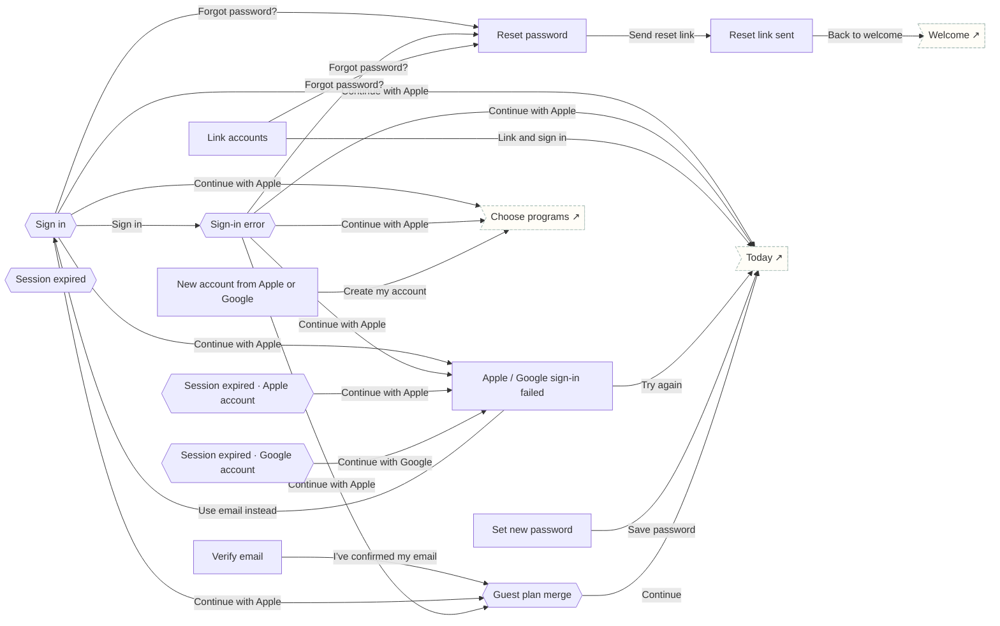

# Account & sign-in

Sign up, verify email, sign in (with error), password reset, guest-plan merge, session expiry.

## Screens

| Screen | Route | Kind / state | Phase |
|---|---|---|---|
| [Verify email](../screens/png/auth/auth_verify.png) | `/auth/verify` | screen | account |
| [Sign in](../screens/png/auth/auth_signin.png) | `/auth/signin` | sheet | account |
| [Sign-in error](../screens/png/auth/auth_signin_error.png) | `/auth/signin?state=error` | sheet · error | account |
| [New account from Apple or Google](../screens/png/auth/auth_social_new.png) | `/auth/social/new` | screen | account |
| [Link accounts](../screens/png/auth/auth_link.png) | `/auth/link` | screen | account |
| [Apple / Google sign-in failed](../screens/png/auth/auth_social_error.png) | `/auth/social/error` | screen | account |
| [Reset password](../screens/png/auth/auth_forgot.png) | `/auth/forgot` | screen | account |
| [Reset link sent](../screens/png/auth/auth_forgot_sent.png) | `/auth/forgot/sent` | screen | account |
| [Set new password](../screens/png/auth/auth_newpass.png) | `/auth/reset` | screen | account |
| [Guest plan merge](../screens/png/auth/auth_merge.png) | `/auth/merge` | sheet | account |
| [Session expired](../screens/png/auth/auth_session.png) | `/auth/session` | sheet | account |
| [Session expired · Apple account](../screens/png/auth/auth_session_apple.png) | `/auth/session?state=apple` | sheet · Apple account | account |
| [Session expired · Google account](../screens/png/auth/auth_session_google.png) | `/auth/session?state=google` | sheet · Google account | account |

## Button & action map

| Screen | Element | Action |
|---|---|---|
| Verify email | Back | `back` |
| Verify email | Open email app | `external message://` |
| Verify email | I’ve confirmed my email | `push → auth_merge` |
| Verify email | Resend link (available in 0:42) | `toast “Link sent again”` |
| Sign in | Continue with Apple | `auth (apple): Sign in with Apple result → Success: reset → today | Success · guest plan on phone: push → auth_merge | New Apple ID, no Tether account: replace → ob_programs | Cancelled: toast “Sign-in cancelled” | Error: push → auth_social_error` |
| Sign in | Continue with Google | `auth (google): Sign in with Google result → Success: reset → today | Success · guest plan on phone: push → auth_merge | New Google account, no Tether account: replace → ob_programs | Cancelled: toast “Sign-in cancelled” | Error: push → auth_social_error` |
| Sign in | Forgot password? | `push → auth_forgot` |
| Sign in | Sign in | `POST supabase /auth/v1/token then branch: Sign-in result → Success: reset → today | Success · guest plan on phone: push → auth_merge | Wrong password: push → auth_signin_error` |
| Sign in | Cancel | `close` |
| Sign-in error | Continue with Apple | `auth (apple): Sign in with Apple result → Success: reset → today | Success · guest plan on phone: push → auth_merge | New Apple ID, no Tether account: replace → ob_programs | Cancelled: toast “Sign-in cancelled” | Error: push → auth_social_error` |
| Sign-in error | Continue with Google | `auth (google): Sign in with Google result → Success: reset → today | Success · guest plan on phone: push → auth_merge | New Google account, no Tether account: replace → ob_programs | Cancelled: toast “Sign-in cancelled” | Error: push → auth_social_error` |
| Sign-in error | Forgot password? | `push → auth_forgot` |
| Sign-in error | Try again | `POST supabase /auth/v1/token then branch: Sign-in result → Success: reset → today | Success · guest plan on phone: push → auth_merge | Wrong password: replace → auth_signin_error` |
| Sign-in error | Cancel | `close` |
| New account from Apple or Google | Back | `back` |
| New account from Apple or Google | Create my account | `push → ob_programs` |
| New account from Apple or Google | Use a different account | `back` |
| Link accounts | Back | `back` |
| Link accounts | Forgot password? | `push → auth_forgot` |
| Link accounts | Link and sign in | `POST supabase /auth/v1/user/identities (linkIdentity) then reset → today` |
| Link accounts | Cancel | `back` |
| Apple / Google sign-in failed | Close | `close` |
| Apple / Google sign-in failed | Try again | `auth (google): Sign in with Google result → Success: reset → today | Error: toast “Still can’t reach Google. Try email.”` |
| Apple / Google sign-in failed | Use email instead | `replace → auth_signin` |
| Reset password | Back | `back` |
| Reset password | Send reset link | `POST supabase /auth/v1/recover then replace → auth_forgot_sent` |
| Reset link sent | Back | `back` |
| Reset link sent | Back to welcome | `reset → welcome` |
| Set new password | Close | `close` |
| Set new password | Save password | `PUT supabase /auth/v1/user then reset → today` |
| Guest plan merge | Continue | `POST /v1/quit-plan/guest-import then reset → today` |
| Session expired | Sign in | `POST supabase /auth/v1/token then close` |
| Session expired | Use Face ID | `close` |
| Session expired · Apple account | Continue with Apple | `auth (apple): Sign in with Apple result → Success: close | Cancelled: toast “Still signed out. Rescue works without signing in.” | Error: push → auth_social_error` |
| Session expired · Apple account | Use Face ID | `close` |
| Session expired · Google account | Continue with Google | `auth (google): Sign in with Google result → Success: close | Cancelled: toast “Still signed out. Rescue works without signing in.” | Error: push → auth_social_error` |
| Session expired · Google account | Use Face ID | `close` |
