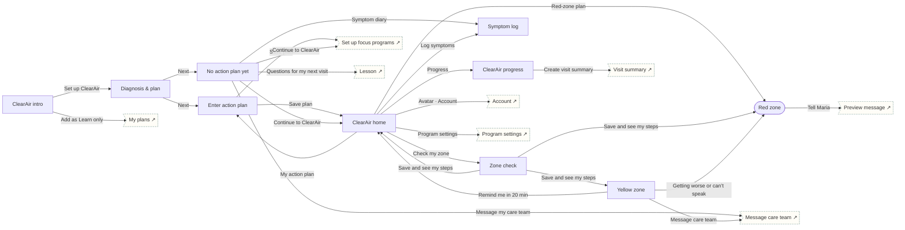

# ClearAir

Respiratory · Manage. Clinician action plan, zone check, yellow-zone steps with re-check, red-zone route, progress against own zones.

## Screens

| Screen | Route | Kind / state | Phase |
|---|---|---|---|
| [ClearAir intro](../screens/png/ca/ca_intro.png) | `/p/ca` | screen | welcome |
| [Diagnosis & plan](../screens/png/ca/ca_q1.png) | `/p/ca/onboarding/1` | screen | onboarding |
| [Enter action plan](../screens/png/ca/ca_plan.png) | `/p/ca/plan` | screen | plan |
| [No action plan yet](../screens/png/ca/ca_noplan.png) | `/p/ca/plan?state=none` | screen · empty | plan |
| [ClearAir home](../screens/png/ca/ca_home.png) | `/p/ca/home` | screen | daily |
| [Zone check](../screens/png/ca/ca_zone.png) | `/p/ca/zone` | screen | daily |
| [Yellow zone](../screens/png/ca/ca_yellow.png) | `/p/ca/zone/yellow` | screen | rescue |
| [Red zone](../screens/png/ca/ca_red.png) | `/p/ca/zone/red` | fullscreen | rescue |
| [Symptom log](../screens/png/ca/ca_symptoms.png) | `/p/ca/symptoms` | screen | daily |
| [ClearAir progress](../screens/png/ca/ca_progress.png) | `/p/ca/progress` | screen | resources |

## Button & action map

| Screen | Element | Action |
|---|---|---|
| ClearAir intro | Back | `back` |
| ClearAir intro | Set up ClearAir | `push → ca_q1` |
| ClearAir intro | Add as Learn only | `POST /v1/enrolments then toast “ClearAir added as Learn only” then tab → plans` |
| Diagnosis & plan | Back | `back` |
| Diagnosis & plan | Next | `decide choice:ca_q1.has_plan: Has a written action plan? → Yes: push → ca_plan | No / Not sure: push → ca_noplan` |
| Enter action plan | Back | `back` |
| Enter action plan | Add a photo of my plan | `toast “Camera opened”` |
| Enter action plan | Save plan | `PUT /v1/program-data/ca/plan then replace → ca_home (onboarding: ob_setup)` |
| No action plan yet | Back | `back` |
| No action plan yet | Symptom diary | `push → ca_symptoms` |
| No action plan yet | Questions for my next visit | `push → learn_lesson` |
| No action plan yet | Message my care team | `push → support_message_care` |
| No action plan yet | Continue to ClearAir | `replace → ca_home (onboarding: ob_setup)` |
| ClearAir home | Back | `back` |
| ClearAir home | Avatar · Account | `push → account` |
| ClearAir home | Check my zone | `push → ca_zone` |
| ClearAir home | Red-zone plan | `push → ca_red` |
| ClearAir home | Log symptoms | `push → ca_symptoms` |
| ClearAir home | Progress | `push → ca_progress` |
| ClearAir home | My action plan | `push → ca_plan` |
| ClearAir home | Program settings | `push → program_settings` |
| ClearAir home | Tab · Today | `tab → today` |
| ClearAir home | Tab · Progress | `tab → progress` |
| ClearAir home | Tab · Learn | `tab → learn` |
| ClearAir home | Tab · Support | `tab → support` |
| Zone check | Back | `back` |
| Zone check | Save and see my steps | `POST /v1/program-data/ca/zone-checks then decide ca.zone: Computed zone → Green: toast “Green zone · follow your daily routine” then replace → ca_home | Yellow: replace → ca_yellow | Red: replace → ca_red | Invalid peak flow: toast “Check your peak flow: 50–900 L/min”` |
| Yellow zone | Back | `back` |
| Yellow zone | Getting worse or can’t speak in full sentences? | `replace → ca_red` |
| Yellow zone | Remind me in 20 min | `toast “Reminder set for 20 minutes” then replace → ca_home` |
| Yellow zone | Message care team | `push → support_message_care` |
| Red zone | Close | `close` |
| Red zone | Call 911 | `call 911` |
| Red zone | Tell Maria | `sheet → support_message` |
| Symptom log | Back | `back` |
| Symptom log | Save | `POST /v1/program-data/ca/symptoms then toast “Saved” then back` |
| ClearAir progress | Back | `back` |
| ClearAir progress | Create visit summary | `push → hw_summary` |
