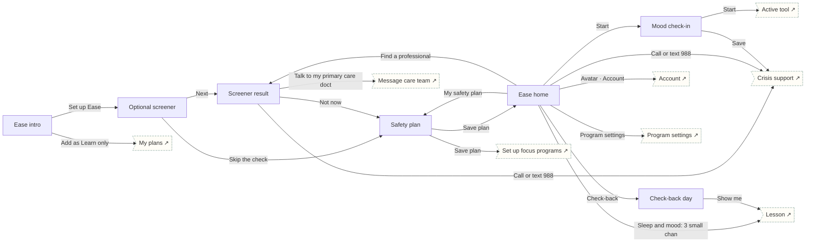

# Ease

Mental & behavioral · Support. Optional PHQ-2/GAD-2, never a diagnosis, safety plan, mood check-in, crisis route, check-back day.

## Screens

| Screen | Route | Kind / state | Phase |
|---|---|---|---|
| [Ease intro](../screens/png/ea/ea_intro.png) | `/p/ea` | screen | welcome |
| [Optional screener](../screens/png/ea/ea_q1.png) | `/p/ea/onboarding/1` | screen | onboarding |
| [Screener result](../screens/png/ea/ea_result.png) | `/p/ea/result` | screen | onboarding |
| [Safety plan](../screens/png/ea/ea_plan.png) | `/p/ea/plan` | screen | plan |
| [Ease home](../screens/png/ea/ea_home.png) | `/p/ea/home` | screen | daily |
| [Mood check-in](../screens/png/ea/ea_mood.png) | `/p/ea/mood` | screen | daily |
| [Check-back day](../screens/png/ea/ea_checkback.png) | `/p/ea/check-back` | screen | milestone |

## Button & action map

| Screen | Element | Action |
|---|---|---|
| Ease intro | Back | `back` |
| Ease intro | Set up Ease | `push → ea_q1` |
| Ease intro | Add as Learn only | `POST /v1/enrolments then toast “Ease added as Learn only” then tab → plans` |
| Optional screener | Back | `back` |
| Optional screener | Next | `push → ea_result` |
| Optional screener | Skip the check | `push → ea_plan` |
| Screener result | Back | `back` |
| Screener result | Find a therapist near me | `external https://findtreatment.gov` |
| Screener result | Talk to my primary care doctor | `push → support_message_care` |
| Screener result | Not now | `push → ea_plan` |
| Screener result | Call or text 988 | `push → crisis` |
| Screener result | Call 911 | `call 911` |
| Safety plan | Back | `back` |
| Safety plan | Save plan | `PUT device:encrypted/ea/safety-plan then replace → ea_home (onboarding: ob_setup)` |
| Ease home | Back | `back` |
| Ease home | Avatar · Account | `push → account` |
| Ease home | Start | `push → ea_mood` |
| Ease home | My safety plan | `push → ea_plan` |
| Ease home | Check-back | `push → ea_checkback` |
| Ease home | Find a professional | `push → ea_result` |
| Ease home | Program settings | `push → program_settings` |
| Ease home | Sleep and mood: 3 small changes | `push → learn_lesson` |
| Ease home | Call or text 988 | `push → crisis` |
| Ease home | Call 911 | `call 911` |
| Ease home | Tab · Today | `tab → today` |
| Ease home | Tab · Progress | `tab → progress` |
| Ease home | Tab · Learn | `tab → learn` |
| Ease home | Tab · Support | `tab → support` |
| Mood check-in | Back | `back` |
| Mood check-in | Start | `push → rescue_active` |
| Mood check-in | Save | `POST /v1/program-data/ea/moods then decide ea.selfharm: Self-harm option selected? → No: toast “Saved” then back | Yes: replace → crisis` |
| Check-back day | Back | `back` |
| Check-back day | Show me | `push → learn_lesson` |
| Check-back day | Save | `POST /v1/program-data/ea/check-backs then toast “Saved” then back` |
