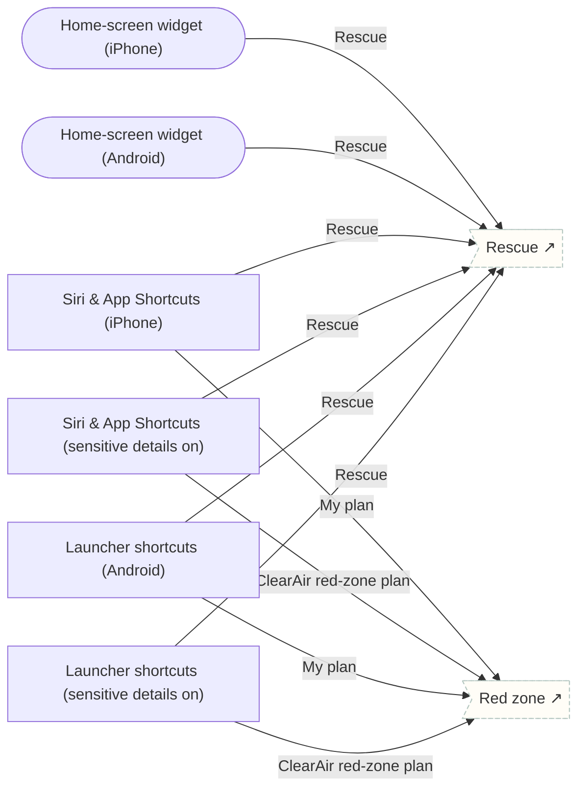

# Home screen, Siri & shortcuts

How Tether looks outside the app: the home-screen widget, Siri and App Shortcuts on iPhone, and launcher shortcuts and the widget on Android. Labels are generic by default; program names appear only when Show sensitive details is on. These are reference surfaces for the native widget and shortcut work, not app routes, and are excluded from release-check counts.

## Screens

| Screen | Route | Kind / state | Phase |
|---|---|---|---|
| [Home-screen widget (iPhone)](../screens/png/entries/surface_widget_ios.png) | `/surface/widget/ios` | fullscreen | rescue |
| [Home-screen widget (Android)](../screens/png/entries/surface_widget_android.png) | `/surface/widget/android` | fullscreen | rescue |
| [Siri & App Shortcuts (iPhone)](../screens/png/entries/surface_shortcuts_ios.png) | `/surface/shortcuts/ios` | screen | rescue |
| [Siri & App Shortcuts (sensitive details on)](../screens/png/entries/surface_shortcuts_ios_named.png) | `/surface/shortcuts/ios?state=named` | screen · Show sensitive details on | rescue |
| [Launcher shortcuts (Android)](../screens/png/entries/surface_shortcuts_android.png) | `/surface/shortcuts/android` | screen | rescue |
| [Launcher shortcuts (sensitive details on)](../screens/png/entries/surface_shortcuts_android_named.png) | `/surface/shortcuts/android?state=named` | screen · Show sensitive details on | rescue |

## Button & action map

| Screen | Element | Action |
|---|---|---|
| Home-screen widget (iPhone) | Close | `close` |
| Home-screen widget (iPhone) | Rescue | `sheet → rescue_pick` |
| Home-screen widget (Android) | Close | `close` |
| Home-screen widget (Android) | Rescue | `sheet → rescue_pick` |
| Siri & App Shortcuts (iPhone) | Close | `close` |
| Siri & App Shortcuts (iPhone) | Rescue | `sheet → rescue_pick` |
| Siri & App Shortcuts (iPhone) | My plan | `push → ca_red` |
| Siri & App Shortcuts (sensitive details on) | Close | `close` |
| Siri & App Shortcuts (sensitive details on) | Rescue | `sheet → rescue_pick` |
| Siri & App Shortcuts (sensitive details on) | ClearAir red-zone plan | `push → ca_red` |
| Launcher shortcuts (Android) | Close | `close` |
| Launcher shortcuts (Android) | Rescue | `sheet → rescue_pick` |
| Launcher shortcuts (Android) | My plan | `push → ca_red` |
| Launcher shortcuts (sensitive details on) | Close | `close` |
| Launcher shortcuts (sensitive details on) | Rescue | `sheet → rescue_pick` |
| Launcher shortcuts (sensitive details on) | ClearAir red-zone plan | `push → ca_red` |
