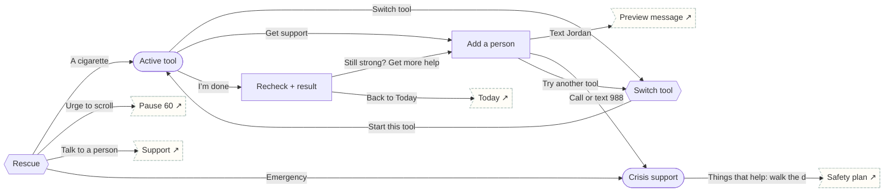

# Universal Rescue

One entry for every Quit program. Opens the last helpful tool; offers a person when intensity stays high; distress always routes to 988.

## Screens

| Screen | Route | Kind / state | Phase |
|---|---|---|---|
| [Rescue](../screens/png/rescue/rescue_pick.png) | `/rescue` | sheet | rescue |
| [Active tool](../screens/png/rescue/rescue_active.png) | `/rescue/breathing` | fullscreen | rescue |
| [Switch tool](../screens/png/rescue/rescue_tools.png) | `/rescue/tools` | sheet | rescue |
| [Recheck + result](../screens/png/rescue/rescue_result.png) | `/rescue/result` | screen | rescue |
| [Add a person](../screens/png/rescue/rescue_escalate.png) | `/rescue/escalate` | screen | rescue |
| [Crisis support](../screens/png/rescue/crisis.png) | `/crisis` | fullscreen | rescue |

## Button & action map

| Screen | Element | Action |
|---|---|---|
| Rescue | A cigarette | `replace → rescue_active` |
| Rescue | Urge to scroll | `replace → sf_pause` |
| Rescue | Stress | `replace → rescue_active` |
| Rescue | Not sure | `replace → rescue_active` |
| Rescue | Start | `replace → rescue_active` |
| Rescue | Talk to a person | `tab → support` |
| Rescue | Emergency | `push → crisis` |
| Active tool | Close | `close` |
| Active tool | Switch tool | `sheet → rescue_tools` |
| Active tool | Get support | `push → rescue_escalate` |
| Active tool | I’m done | `replace → rescue_result` |
| Switch tool | Start this tool | `replace → rescue_active` |
| Switch tool | Cancel | `close` |
| Recheck + result | Close | `close` |
| Recheck + result | Still strong? Get more help | `push → rescue_escalate` |
| Recheck + result | Back to Today | `POST /v1/records/rescues then reset → today` |
| Add a person | Close | `close` |
| Add a person | Call | `call 1-800-784-8669` |
| Add a person | Text Jordan | `sheet → support_message` |
| Add a person | Call or text 988 | `push → crisis` |
| Add a person | Call 911 | `call 911` |
| Add a person | Try another tool | `sheet → rescue_tools` |
| Crisis support | Close | `close` |
| Crisis support | Call 988 | `call 988` |
| Crisis support | Text 988 | `sms 988` |
| Crisis support | Call 911 | `call 911` |
| Crisis support | Things that help: walk the dog, shower, music | `push → ea_plan` |
