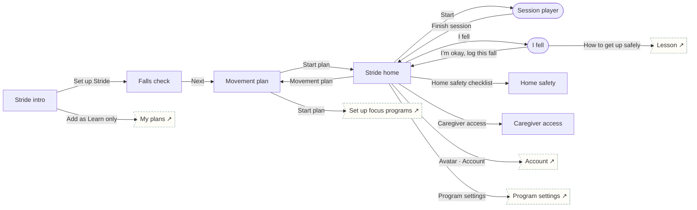

# Stride

Healthy aging · Build habits. Falls check, weekly movement plan, audio-first sessions, I-fell route, home safety, scoped caregiver access.

## Screens

| Screen | Route | Kind / state | Phase |
|---|---|---|---|
| [Stride intro](../screens/png/sd/sd_intro.png) | `/p/sd` | screen | welcome |
| [Falls check](../screens/png/sd/sd_q1.png) | `/p/sd/onboarding/1` | screen | onboarding |
| [Movement plan](../screens/png/sd/sd_plan.png) | `/p/sd/plan` | screen | plan |
| [Stride home](../screens/png/sd/sd_home.png) | `/p/sd/home` | screen | daily |
| [Session player](../screens/png/sd/sd_session.png) | `/p/sd/session` | fullscreen | daily |
| [I fell](../screens/png/sd/sd_fell.png) | `/p/sd/fell` | fullscreen | rescue |
| [Home safety](../screens/png/sd/sd_safety.png) | `/p/sd/safety` | screen | resources |
| [Caregiver access](../screens/png/sd/sd_caregiver.png) | `/p/sd/caregiver` | screen | account |

## Button & action map

| Screen | Element | Action |
|---|---|---|
| Stride intro | Back | `back` |
| Stride intro | Set up Stride | `push → sd_q1` |
| Stride intro | Add as Learn only | `POST /v1/enrolments then toast “Stride added as Learn only” then tab → plans` |
| Falls check | Back | `back` |
| Falls check | Next | `push → sd_plan` |
| Movement plan | Back | `back` |
| Movement plan | Start plan | `PUT /v1/program-data/sd/plan then replace → sd_home (onboarding: ob_setup)` |
| Stride home | Back | `back` |
| Stride home | Avatar · Account | `push → account` |
| Stride home | Start | `push → sd_session` |
| Stride home | I fell | `push → sd_fell` |
| Stride home | Home safety checklist | `push → sd_safety` |
| Stride home | Caregiver access | `push → sd_caregiver` |
| Stride home | Movement plan | `push → sd_plan` |
| Stride home | Program settings | `push → program_settings` |
| Stride home | Tab · Today | `tab → today` |
| Stride home | Tab · Progress | `tab → progress` |
| Stride home | Tab · Learn | `tab → learn` |
| Stride home | Tab · Support | `tab → support` |
| Session player | Close | `close` |
| Session player | Next exercise | `toast “Exercise 3 of 6”` |
| Session player | Finish session | `POST /v1/program-data/sd/sessions then toast “Session saved” then replace → sd_home` |
| I fell | Close | `close` |
| I fell | I hit my head or can’t get up · Call 911 | `call 911` |
| I fell | Call Rosa | `call (555) 010-2244` |
| I fell | How to get up safely | `push → learn_lesson` |
| I fell | I’m okay, log this fall | `POST /v1/program-data/sd/falls then toast “Fall logged. Added to your visit list.” then replace → sd_home` |
| Home safety | Back | `back` |
| Home safety | Save | `PUT /v1/program-data/sd/safety then toast “Saved” then back` |
| Caregiver access | Back | `back` |
| Caregiver access | Send invite | `POST /v1/care/caregivers then toast “Invite sent to Rosa” then back` |
