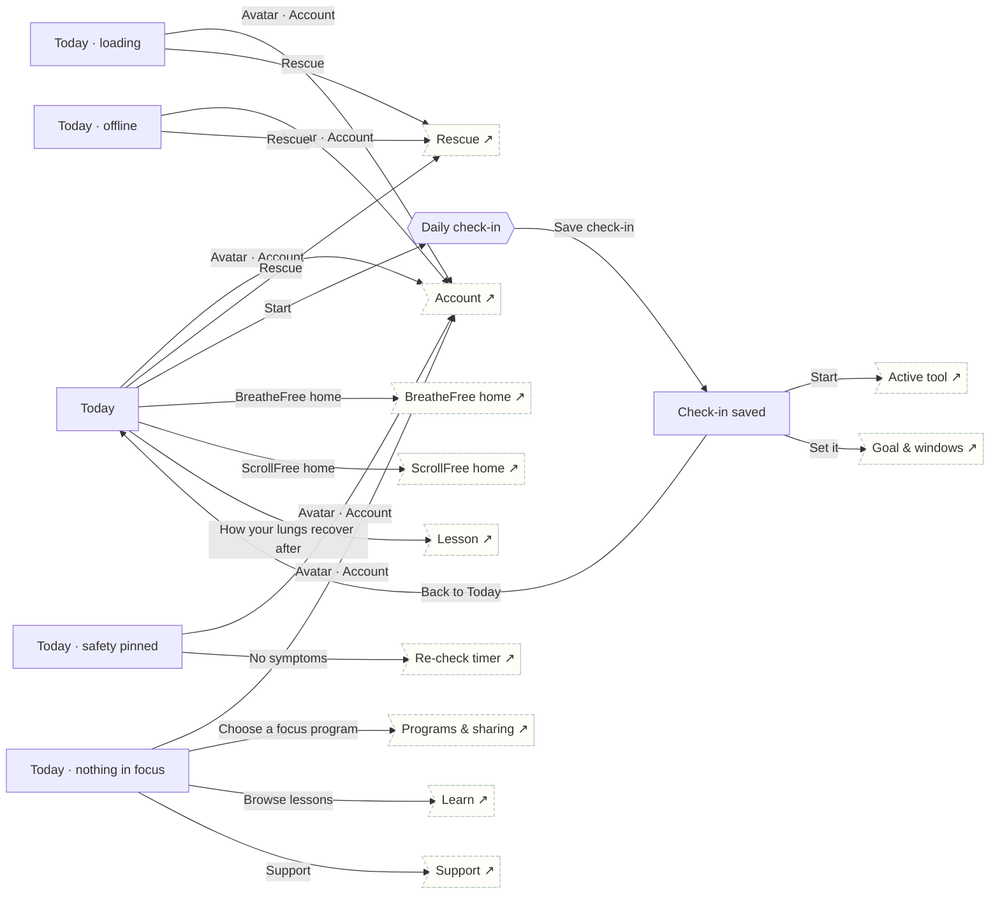

# Today

The shared home: Rescue first, one step per focus program, combined check-in, milestones and Learn-only lessons. Every state is specified.

## Screens

| Screen | Route | Kind / state | Phase |
|---|---|---|---|
| [Today](../screens/png/today/today.png) | `/today` | screen | daily |
| [Today · loading](../screens/png/today/today_loading.png) | `/today?state=loading` | screen · loading | daily |
| [Today · offline](../screens/png/today/today_offline.png) | `/today?state=offline` | screen · offline | daily |
| [Today · nothing in focus](../screens/png/today/today_empty.png) | `/today?state=empty` | screen · empty | daily |
| [Today · safety pinned](../screens/png/today/today_safety.png) | `/today?state=safety` | screen · safety | rescue |
| [Daily check-in](../screens/png/today/checkin.png) | `/check-in` | sheet | daily |
| [Check-in saved](../screens/png/today/checkin_done.png) | `/check-in/done` | screen | daily |

## Button & action map

| Screen | Element | Action |
|---|---|---|
| Today | Avatar · Account | `push → account` |
| Today | Rescue | `sheet → rescue_pick` |
| Today | Start | `sheet → checkin` |
| Today | BreatheFree home | `push → bf_home` |
| Today | ScrollFree home | `push → sf_home` |
| Today | How your lungs recover after you quit | `push → learn_lesson` |
| Today | Tab · Plans | `tab → plans` |
| Today | Tab · Progress | `tab → progress` |
| Today | Tab · Learn | `tab → learn` |
| Today | Tab · Support | `tab → support` |
| Today · loading | Avatar · Account | `push → account` |
| Today · loading | Rescue | `sheet → rescue_pick` |
| Today · loading | Tab · Plans | `tab → plans` |
| Today · loading | Tab · Progress | `tab → progress` |
| Today · loading | Tab · Learn | `tab → learn` |
| Today · loading | Tab · Support | `tab → support` |
| Today · offline | Avatar · Account | `push → account` |
| Today · offline | Rescue | `sheet → rescue_pick` |
| Today · offline | Tab · Plans | `tab → plans` |
| Today · offline | Tab · Progress | `tab → progress` |
| Today · offline | Tab · Learn | `tab → learn` |
| Today · offline | Tab · Support | `tab → support` |
| Today · nothing in focus | Avatar · Account | `push → account` |
| Today · nothing in focus | Choose a focus program | `push → account_programs` |
| Today · nothing in focus | Browse lessons | `tab → learn` |
| Today · nothing in focus | Support | `tab → support` |
| Today · nothing in focus | Tab · Plans | `tab → plans` |
| Today · nothing in focus | Tab · Progress | `tab → progress` |
| Today · nothing in focus | Tab · Learn | `tab → learn` |
| Today · nothing in focus | Tab · Support | `tab → support` |
| Today · safety pinned | Avatar · Account | `push → account` |
| Today · safety pinned | Yes · call 911 | `call 911` |
| Today · safety pinned | No symptoms | `push → hw_recheck` |
| Today · safety pinned | Tab · Plans | `tab → plans` |
| Today · safety pinned | Tab · Progress | `tab → progress` |
| Today · safety pinned | Tab · Learn | `tab → learn` |
| Today · safety pinned | Tab · Support | `tab → support` |
| Daily check-in | Save check-in | `POST /v1/records/check-ins then replace → checkin_done` |
| Check-in saved | Close | `close` |
| Check-in saved | Start | `push → rescue_active` |
| Check-in saved | Set it | `push → sf_goal` |
| Check-in saved | Back to Today | `reset → today` |
