# ScrollFree · Unplug

Optional app limits for ScrollFree: what Unplug can see, Screen Time / Android permissions, choosing apps, limits and the pause screen, focus sessions, the iPhone shield and Android overlay, the small-step gate, tracking check and turning it off. Every pause surface reaches Rescue. Entry: the Unplug card on ScrollFree home. Related states elsewhere: ScrollFree home (Unplug on), Weekly reflection (Unplug on), Program settings (ScrollFree), Connect Screen Time (Android).

```mermaid
flowchart LR
  sf_unplug_intro["Unplug intro"]
  sf_unplug_auth["Allow Screen Time"]
  sf_unplug_auth_denied["Screen Time not allowed"]
  sf_unplug_auth_unavailable["Screen Time unavailable"]
  sf_unplug_auth_notifications["Notifications off"]
  sf_unplug_auth_android["Android permissions for Unplug"]
  sf_unplug_apps["Choose apps"]
  sf_unplug_picker_ios{{"Apple app picker"}}
  sf_unplug_apps_android["Choose apps (Android)"]
  sf_unplug_apps_chosen["Name your groups"]
  sf_unplug_limits["Limits & pause screen"]
  sf_unplug_home["Unplug"]
  sf_unplug_session["Start a focus session"]
  sf_unplug_session_active(["Focus session running"])
  sf_unplug_session_end{{"End session early"}}
  sf_unplug_session_done["Session complete"]
  sf_unplug_session_done_early["Session ended early"]
  sf_unplug_shield(["Pause screen (iPhone shield)"])
  sf_unplug_shield_firm(["Pause screen (iPhone shield, firm)"])
  sf_unplug_overlay(["Pause screen (Android overlay)"])
  sf_unplug_gate(["Small step: one breath"])
  sf_unplug_gate_commit(["Small step: type a sentence"])
  sf_unplug_gate_sum(["Small step: quick sum"])
  sf_unplug_health["Tracking check"]
  sf_unplug_health_notifications["Tracking check · notifications off"]
  sf_unplug_health_stopped["Tracking stopped"]
  sf_unplug_health_android["Tracking check (Android)"]
  sf_unplug_off{{"Turn off Unplug"}}
  sf_unplug_intro -->|"Set up Unplug"| sf_unplug_auth
  sf_unplug_intro -->|"Set up Unplug"| sf_unplug_auth_android
  sf_unplug_auth -->|"Continue"| sf_unplug_apps
  sf_unplug_auth -->|"Continue"| sf_unplug_auth_notifications
  sf_unplug_auth -->|"Continue"| sf_unplug_auth_denied
  sf_unplug_auth -->|"Continue"| sf_unplug_auth_unavailable
  sf_unplug_auth_denied -->|"Try again"| sf_unplug_apps
  sf_unplug_auth_notifications -->|"Check again"| sf_unplug_apps
  sf_unplug_auth_notifications -->|"Check again"| sf_unplug_apps_android
  sf_unplug_auth_android -->|"I’ve turned them on"| sf_unplug_apps_android
  sf_unplug_auth_android -->|"I’ve turned them on"| sf_unplug_auth_notifications
  sf_unplug_apps -->|"Open app picker"| sf_unplug_picker_ios
  sf_unplug_picker_ios -->|"Done"| sf_unplug_apps_chosen
  sf_unplug_apps_android -->|"Done · 3 apps"| sf_unplug_apps_chosen
  sf_unplug_apps_chosen -->|"Add another group"| sf_unplug_picker_ios
  sf_unplug_apps_chosen -->|"Next: limits"| sf_unplug_limits
  sf_unplug_limits -->|"Save limits"| sf_unplug_home
  sf_unplug_home -->|"Start"| sf_unplug_session
  sf_unplug_home -->|"Apps"| sf_unplug_apps_chosen
  sf_unplug_home -->|"Limits & pause screen"| sf_unplug_limits
  sf_unplug_home -->|"Preview the pause screen"| sf_unplug_shield
  sf_unplug_home -->|"Preview the pause screen"| sf_unplug_overlay
  sf_unplug_home -->|"Tracking check"| sf_unplug_health
  sf_unplug_home -->|"How Unplug works"| sf_unplug_intro
  sf_unplug_home -->|"Turn off Unplug"| sf_unplug_off
  sf_unplug_session -->|"Start session"| sf_unplug_session_active
  sf_unplug_session_active -->|"Pause 60"| sf_pause
  sf_unplug_session_active -->|"End early"| sf_unplug_session_end
  sf_unplug_session_end -->|"End session"| sf_unplug_session_done_early
  sf_unplug_session_done -->|"Done"| sf_unplug_home
  sf_unplug_session_done_early -->|"Done"| sf_unplug_home
  sf_unplug_shield -->|"Take a breath"| sf_unplug_gate
  sf_unplug_shield -->|"Take a breath"| rescue_pick
  sf_unplug_shield_firm -->|"Get support"| rescue_pick
  sf_unplug_overlay -->|"Get support"| rescue_pick
  sf_unplug_gate -->|"Get support"| rescue_pick
  sf_unplug_gate -->|"Keep it closed"| sf_home
  sf_unplug_gate_commit -->|"Get support"| rescue_pick
  sf_unplug_gate_commit -->|"Keep it closed"| sf_home
  sf_unplug_gate_sum -->|"Get support"| rescue_pick
  sf_unplug_gate_sum -->|"Keep it closed"| sf_home
  sf_unplug_health_notifications -->|"Check again"| sf_unplug_health
  sf_unplug_health_stopped -->|"Check again"| sf_unplug_health
  sf_unplug_off -->|"Turn off"| sf_home
  rescue_pick>"Rescue ↗"]
  class rescue_pick ext
  sf_home>"ScrollFree home ↗"]
  class sf_home ext
  sf_pause>"Pause 60 ↗"]
  class sf_pause ext
  classDef ext fill:#FFFDF7,stroke:#B6C8C2,stroke-dasharray: 4 3
```

## Screens

| Screen | Route | Kind / state | Phase |
|---|---|---|---|
| [Unplug intro](../screens/png/unplug/sf_unplug_intro.png) | `/p/sf/unplug` | screen | plan |
| [Allow Screen Time](../screens/png/unplug/sf_unplug_auth.png) | `/p/sf/unplug/permission` | screen | plan |
| [Screen Time not allowed](../screens/png/unplug/sf_unplug_auth_denied.png) | `/p/sf/unplug/permission?state=denied` | screen · permission denied | plan |
| [Screen Time unavailable](../screens/png/unplug/sf_unplug_auth_unavailable.png) | `/p/sf/unplug/permission?state=unavailable` | screen · unavailable | plan |
| [Notifications off](../screens/png/unplug/sf_unplug_auth_notifications.png) | `/p/sf/unplug/permission?state=notifications` | screen · notifications off | plan |
| [Android permissions for Unplug](../screens/png/unplug/sf_unplug_auth_android.png) | `/p/sf/unplug/permission?state=android` | screen · android | plan |
| [Choose apps](../screens/png/unplug/sf_unplug_apps.png) | `/p/sf/unplug/apps` | screen | plan |
| [Apple app picker](../screens/png/unplug/sf_unplug_picker_ios.png) | `/p/sf/unplug/apps/picker` | sheet | plan |
| [Choose apps (Android)](../screens/png/unplug/sf_unplug_apps_android.png) | `/p/sf/unplug/apps?state=android` | screen · android | plan |
| [Name your groups](../screens/png/unplug/sf_unplug_apps_chosen.png) | `/p/sf/unplug/apps?state=chosen` | screen · apps chosen | plan |
| [Limits & pause screen](../screens/png/unplug/sf_unplug_limits.png) | `/p/sf/unplug/limits` | screen | plan |
| [Unplug](../screens/png/unplug/sf_unplug_home.png) | `/p/sf/unplug/home` | screen | daily |
| [Start a focus session](../screens/png/unplug/sf_unplug_session.png) | `/p/sf/unplug/session` | screen | rescue |
| [Focus session running](../screens/png/unplug/sf_unplug_session_active.png) | `/p/sf/unplug/session/active` | fullscreen | rescue |
| [End session early](../screens/png/unplug/sf_unplug_session_end.png) | `/p/sf/unplug/session/end` | sheet | rescue |
| [Session complete](../screens/png/unplug/sf_unplug_session_done.png) | `/p/sf/unplug/session/done` | screen | milestone |
| [Session ended early](../screens/png/unplug/sf_unplug_session_done_early.png) | `/p/sf/unplug/session/done?state=early` | screen · ended early | milestone |
| [Pause screen (iPhone shield)](../screens/png/unplug/sf_unplug_shield.png) | `/system/unplug/shield` | fullscreen | rescue |
| [Pause screen (iPhone shield, firm)](../screens/png/unplug/sf_unplug_shield_firm.png) | `/system/unplug/shield?state=firm` | fullscreen · no “open anyway” left | rescue |
| [Pause screen (Android overlay)](../screens/png/unplug/sf_unplug_overlay.png) | `/system/unplug/overlay` | fullscreen | rescue |
| [Small step: one breath](../screens/png/unplug/sf_unplug_gate.png) | `/p/sf/unplug/step` | fullscreen | rescue |
| [Small step: type a sentence](../screens/png/unplug/sf_unplug_gate_commit.png) | `/p/sf/unplug/step?state=sentence` | fullscreen · typed sentence | rescue |
| [Small step: quick sum](../screens/png/unplug/sf_unplug_gate_sum.png) | `/p/sf/unplug/step?state=sum` | fullscreen · quick sum | rescue |
| [Tracking check](../screens/png/unplug/sf_unplug_health.png) | `/p/sf/unplug/health` | screen | daily |
| [Tracking check · notifications off](../screens/png/unplug/sf_unplug_health_notifications.png) | `/p/sf/unplug/health?state=notifications` | screen · notifications off | daily |
| [Tracking stopped](../screens/png/unplug/sf_unplug_health_stopped.png) | `/p/sf/unplug/health?state=stopped` | screen · tracking stopped | daily |
| [Tracking check (Android)](../screens/png/unplug/sf_unplug_health_android.png) | `/p/sf/unplug/health?state=android` | screen · android | daily |
| [Turn off Unplug](../screens/png/unplug/sf_unplug_off.png) | `/p/sf/unplug/off` | sheet | account |

## Button & action map

| Screen | Element | Action |
|---|---|---|
| Unplug intro | Back | `back` |
| Unplug intro | Set up Unplug | `branch: Platform → iPhone: push → sf_unplug_auth | Android: push → sf_unplug_auth_android` |
| Unplug intro | Not now | `back` |
| Allow Screen Time | Back | `back` |
| Allow Screen Time | Continue | `branch: Screen Time authorization (iOS Family Controls, individual) → Approved: replace → sf_unplug_apps | Approved · notifications off: replace → sf_unplug_auth_notifications | Denied: replace → sf_unplug_auth_denied | Unavailable: replace → sf_unplug_auth_unavailable` |
| Allow Screen Time | Not now | `back` |
| Screen Time not allowed | Back | `back` |
| Screen Time not allowed | Try again | `branch: Screen Time authorization (iOS Family Controls, individual) → Approved: replace → sf_unplug_apps | Denied: toast “Still not allowed. You can turn it on later in Settings.”` |
| Screen Time not allowed | Open phone settings | `os_settings` |
| Screen Time not allowed | Not now | `back` |
| Screen Time unavailable | Back | `back` |
| Screen Time unavailable | Back to ScrollFree | `back` |
| Notifications off | Back | `back` |
| Notifications off | Open phone settings | `os_settings` |
| Notifications off | Check again | `branch: Notification permission (checked on return) → On (iPhone): replace → sf_unplug_apps | On (Android): replace → sf_unplug_apps_android | Still off: toast “Notifications are still off. You can turn them on later in Settings.”` |
| Notifications off | Continue without notifications | `branch: Platform → iPhone: replace → sf_unplug_apps | Android: replace → sf_unplug_apps_android` |
| Android permissions for Unplug | Back | `back` |
| Android permissions for Unplug | Turn on display over apps | `os_settings` |
| Android permissions for Unplug | Turn on usage access | `os_settings` |
| Android permissions for Unplug | I’ve turned them on | `branch: Android permissions (checked on return) → All on: replace → sf_unplug_apps_android | Notifications off: replace → sf_unplug_auth_notifications | Missing: toast “Unplug still needs both settings.”` |
| Choose apps | Back | `back` |
| Choose apps | Open app picker | `sheet → sf_unplug_picker_ios` |
| Choose apps | Not now | `back` |
| Apple app picker | Done | `branch: System app picker result → Apps chosen: replace → sf_unplug_apps_chosen | Cancelled: close` |
| Apple app picker | Cancel | `close` |
| Choose apps (Android) | Back | `back` |
| Choose apps (Android) | Done · 3 apps | `replace → sf_unplug_apps_chosen` |
| Choose apps (Android) | Cancel | `back` |
| Name your groups | Back | `back` |
| Name your groups | Add another group | `sheet → sf_unplug_picker_ios` |
| Name your groups | Next: limits | `push → sf_unplug_limits` |
| Limits & pause screen | Back | `back` |
| Limits & pause screen | Save limits | `CALL device:unplug/setThresholds+applyShield then toast “Unplug is on” then replace → sf_unplug_home` |
| Unplug | Back | `back` |
| Unplug | Start | `push → sf_unplug_session` |
| Unplug | Apps | `push → sf_unplug_apps_chosen` |
| Unplug | Limits & pause screen | `push → sf_unplug_limits` |
| Unplug | Preview the pause screen | `branch: Platform → iPhone: push → sf_unplug_shield | Android: push → sf_unplug_overlay` |
| Unplug | Tracking check | `push → sf_unplug_health` |
| Unplug | How Unplug works | `push → sf_unplug_intro` |
| Unplug | Turn off Unplug | `sheet → sf_unplug_off` |
| Start a focus session | Back | `back` |
| Start a focus session | Start session | `CALL device:unplug/startSession then replace → sf_unplug_session_active` |
| Focus session running | Close | `close` |
| Focus session running | Pause 60 | `push → sf_pause` |
| Focus session running | End early | `sheet → sf_unplug_session_end` |
| End session early | End session | `decide sf.unplug.reason: Strict session: reason given? → Reason given: CALL device:unplug/endSession then replace → sf_unplug_session_done_early | No reason yet: toast “Choose or type a reason to end a strict session.”` |
| End session early | Keep going | `close` |
| Session complete | Done | `replace → sf_unplug_home` |
| Session ended early | Done | `replace → sf_unplug_home` |
| Pause screen (iPhone shield) | Take a breath | `toast “Notification: open Tether to take your breath, or get support” then branch: Notification action → Take my breath: push → sf_unplug_gate | Get support: sheet → rescue_pick` |
| Pause screen (iPhone shield) | Open anyway | `toast “Opened · 1 “open anyway” left today” then close` |
| Pause screen (iPhone shield, firm) | Close the app | `toast “The app stays closed.” then close` |
| Pause screen (iPhone shield, firm) | Get support | `toast “Notification: tap to open Rescue in Tether” then sheet → rescue_pick` |
| Pause screen (Android overlay) | Close the app | `toast “The app stays closed.” then close` |
| Pause screen (Android overlay) | Get support | `sheet → rescue_pick` |
| Pause screen (Android overlay) | Open anyway | `toast “Opened · 1 “open anyway” left today” then close` |
| Small step: one breath | Close | `close` |
| Small step: one breath | Get support | `sheet → rescue_pick` |
| Small step: one breath | Keep it closed | `toast “Nice. The app stays closed.” then reset → sf_home` |
| Small step: one breath | Open it for 10 minutes | `toast “Open for 10 minutes. The pause screen comes back after.” then reset → sf_home` |
| Small step: type a sentence | Close | `close` |
| Small step: type a sentence | Get support | `sheet → rescue_pick` |
| Small step: type a sentence | Keep it closed | `toast “Nice. The app stays closed.” then reset → sf_home` |
| Small step: type a sentence | Open it for 10 minutes | `decide sf.unplug.sentence: Small step done? → Step done: toast “Open for 10 minutes. The pause screen comes back after.” then reset → sf_home | Step not done: toast “Type the whole sentence first.”` |
| Small step: quick sum | Close | `close` |
| Small step: quick sum | Get support | `sheet → rescue_pick` |
| Small step: quick sum | Keep it closed | `toast “Nice. The app stays closed.” then reset → sf_home` |
| Small step: quick sum | Open it for 10 minutes | `decide sf.unplug.sum: Small step done? → Step done: toast “Open for 10 minutes. The pause screen comes back after.” then reset → sf_home | Step not done: toast “Answer the sum first.”` |
| Tracking check | Back | `back` |
| Tracking check | Done | `back` |
| Tracking check · notifications off | Back | `back` |
| Tracking check · notifications off | Open phone settings | `os_settings` |
| Tracking check · notifications off | Check again | `branch: Notification permission (checked on return) → On: replace → sf_unplug_health | Still off: toast “Notifications are still off.”` |
| Tracking stopped | Back | `back` |
| Tracking stopped | Open phone settings | `os_settings` |
| Tracking stopped | Check again | `branch: Tracking health result → All pass: replace → sf_unplug_health | Still failing: toast “Still not working. Turn Screen Time access on again in Settings.”` |
| Tracking check (Android) | Back | `back` |
| Tracking check (Android) | Battery settings | `os_settings` |
| Tracking check (Android) | Done | `back` |
| Turn off Unplug | Turn off | `decide choice:sf_unplug_off.scope: Chosen option → Unplug only: CALL device:unplug/liftShield+purgeLocalData then toast “Unplug is off” then reset → sf_home | Unplug and Screen Time: PATCH /v1/enrolments/consents then toast “Unplug and Screen Time are off” then reset → sf_home` |
| Turn off Unplug | Cancel | `close` |
