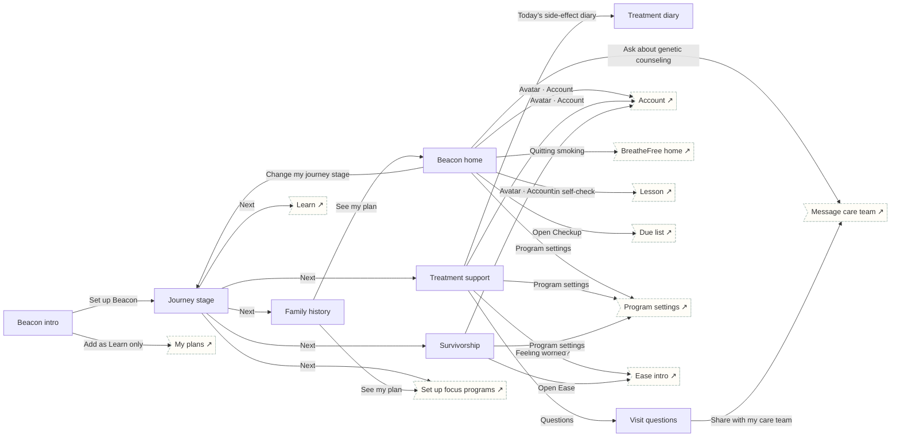

# Beacon

Cancer · Prevent. Four journey paths: lowering risk, in treatment, after treatment, caregiver. Fever rule on the treatment path.

## Screens

| Screen | Route | Kind / state | Phase |
|---|---|---|---|
| [Beacon intro](../screens/png/be/be_intro.png) | `/p/be` | screen | welcome |
| [Journey stage](../screens/png/be/be_q1.png) | `/p/be/onboarding/1` | screen | onboarding |
| [Family history](../screens/png/be/be_q2.png) | `/p/be/onboarding/2` | screen | onboarding |
| [Beacon home](../screens/png/be/be_home.png) | `/p/be/home` | screen | daily |
| [Treatment support](../screens/png/be/be_tx.png) | `/p/be/treatment` | screen | daily |
| [Treatment diary](../screens/png/be/be_diary.png) | `/p/be/diary` | screen | daily |
| [Visit questions](../screens/png/be/be_questions.png) | `/p/be/questions` | screen | milestone |
| [Survivorship](../screens/png/be/be_survivor.png) | `/p/be/survivorship` | screen | milestone |

## Button & action map

| Screen | Element | Action |
|---|---|---|
| Beacon intro | Back | `back` |
| Beacon intro | Set up Beacon | `push → be_q1` |
| Beacon intro | Add as Learn only | `toast “Beacon added as Learn only” then tab → plans` |
| Journey stage | Back | `back` |
| Journey stage | Next | `decide choice:be_q1.stage: Journey stage → Lowering my risk: push → be_q2 | Going through treatment: replace → be_tx (onboarding: ob_setup) | After treatment: replace → be_survivor (onboarding: ob_setup) | Supporting someone: tab → learn` |
| Family history | Back | `back` |
| Family history | See my plan | `PUT /v1/program-data/be/profile then replace → be_home (onboarding: ob_setup)` |
| Beacon home | Back | `back` |
| Beacon home | Avatar · Account | `push → account` |
| Beacon home | Quitting smoking | `push → bf_home` |
| Beacon home | Monthly skin self-check | `push → learn_lesson` |
| Beacon home | Ask about genetic counseling | `push → support_message_care` |
| Beacon home | Open Checkup | `push → ck_list` |
| Beacon home | Change my journey stage | `push → be_q1` |
| Beacon home | Program settings | `push → program_settings` |
| Beacon home | Tab · Today | `tab → today` |
| Beacon home | Tab · Progress | `tab → progress` |
| Beacon home | Tab · Learn | `tab → learn` |
| Beacon home | Tab · Support | `tab → support` |
| Treatment support | Back | `back` |
| Treatment support | Avatar · Account | `push → account` |
| Treatment support | Questions | `push → be_questions` |
| Treatment support | Call | `call (555) 010-7000` |
| Treatment support | Today’s side-effect diary | `push → be_diary` |
| Treatment support | Feeling worried? | `push → ea_intro` |
| Treatment support | Program settings | `push → program_settings` |
| Treatment support | Tab · Today | `tab → today` |
| Treatment support | Tab · Progress | `tab → progress` |
| Treatment support | Tab · Learn | `tab → learn` |
| Treatment support | Tab · Support | `tab → support` |
| Treatment diary | Back | `back` |
| Treatment diary | Call | `call (555) 010-7000` |
| Treatment diary | Save | `POST /v1/program-data/be/diary then toast “Saved” then back` |
| Visit questions | Back | `back` |
| Visit questions | Share with my care team | `push → support_message_care` |
| Visit questions | Done | `back` |
| Survivorship | Back | `back` |
| Survivorship | Avatar · Account | `push → account` |
| Survivorship | Open Ease | `push → ea_intro` |
| Survivorship | Program settings | `push → program_settings` |
| Survivorship | Save check-in | `POST /v1/program-data/be/survivorship then toast “Saved”` |
| Survivorship | Tab · Today | `tab → today` |
| Survivorship | Tab · Progress | `tab → progress` |
| Survivorship | Tab · Learn | `tab → learn` |
| Survivorship | Tab · Support | `tab → support` |
