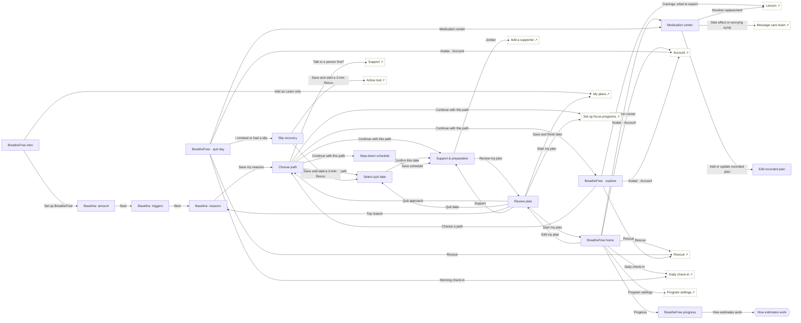

# BreatheFree

Tobacco & nicotine · Quit / Reduce. Four real quit paths, craving rescue, slip recovery, medication education.

## Screens

| Screen | Route | Kind / state | Phase |
|---|---|---|---|
| [BreatheFree intro](../screens/png/bf/bf_intro.png) | `/p/bf` | screen | welcome |
| [Baseline: amount](../screens/png/bf/bf_q1.png) | `/p/bf/onboarding/1` | screen | onboarding |
| [Baseline: triggers](../screens/png/bf/bf_q2.png) | `/p/bf/onboarding/2` | screen | onboarding |
| [Baseline: reasons](../screens/png/bf/bf_q3.png) | `/p/bf/onboarding/3` | screen | onboarding |
| [Choose path](../screens/png/bf/bf_path.png) | `/p/bf/plan/path` | screen | plan |
| [Select quit date](../screens/png/bf/bf_date.png) | `/p/bf/plan/date` | screen | plan |
| [Step-down schedule](../screens/png/bf/bf_stepdown.png) | `/p/bf/plan/reduce` | screen | plan |
| [Support & preparation](../screens/png/bf/bf_support.png) | `/p/bf/plan/support` | screen | plan |
| [Review plan](../screens/png/bf/bf_review.png) | `/p/bf/plan/review` | screen | plan |
| [BreatheFree home](../screens/png/bf/bf_home.png) | `/p/bf/home` | screen | daily |
| [BreatheFree · quit day](../screens/png/bf/bf_home_quitday.png) | `/p/bf/home?state=quit-day` | screen · quit day | milestone |
| [BreatheFree · explore](../screens/png/bf/bf_home_explore.png) | `/p/bf/home?state=explore` | screen · explore | daily |
| [Slip recovery](../screens/png/bf/bf_slip.png) | `/p/bf/slip` | screen | milestone |
| [Medication center](../screens/png/bf/bf_meds.png) | `/p/bf/meds` | screen | resources |
| [Edit recorded plan](../screens/png/bf/bf_meds_edit.png) | `/p/bf/meds/edit` | screen | resources |
| [BreatheFree progress](../screens/png/bf/bf_progress.png) | `/p/bf/progress` | screen | resources |
| [How estimates work](../screens/png/bf/bf_estimates.png) | `/p/bf/progress/estimates` | sheet | resources |

## Button & action map

| Screen | Element | Action |
|---|---|---|
| BreatheFree intro | Back | `back` |
| BreatheFree intro | Set up BreatheFree | `push → bf_q1` |
| BreatheFree intro | Add as Learn only | `toast “BreatheFree added as Learn only” then tab → plans` |
| Baseline: amount | Back | `back` |
| Baseline: amount | Next | `push → bf_q2` |
| Baseline: triggers | Back | `back` |
| Baseline: triggers | Next | `push → bf_q3` |
| Baseline: reasons | Back | `back` |
| Baseline: reasons | Save my reasons | `push → bf_path` |
| Choose path | Back | `back` |
| Choose path | Talk to a person first? | `tab → support` |
| Choose path | Continue with this path | `decide choice:bf_path.path: Selected path → Set a quit date: push → bf_date | Quit today: push → bf_support | Reduce gradually: push → bf_stepdown | Explore first: replace → bf_home_explore (onboarding: ob_setup)` |
| Select quit date | Back | `back` |
| Select quit date | Confirm this date | `push → bf_support` |
| Step-down schedule | Back | `back` |
| Step-down schedule | Save schedule | `push → bf_support` |
| Support & preparation | Back | `back` |
| Support & preparation | Jordan | `push → support_add_person` |
| Support & preparation | Add a supporter | `push → support_add_person` |
| Support & preparation | Review my plan | `push → bf_review` |
| Review plan | Back | `back` |
| Review plan | Quit approach | `push → bf_path` |
| Review plan | Quit date | `push → bf_date` |
| Review plan | Top reason | `push → bf_q3` |
| Review plan | Support | `push → bf_support` |
| Review plan | Space | `push → bf_support` |
| Review plan | Start my plan | `PUT /v1/quit-plan then replace → bf_home (onboarding: ob_setup)` |
| Review plan | Save and finish later | `tab → plans` |
| BreatheFree home | Back | `back` |
| BreatheFree home | Avatar · Account | `push → account` |
| BreatheFree home | Rescue | `sheet → rescue_pick` |
| BreatheFree home | Daily check-in | `sheet → checkin` |
| BreatheFree home | Medication center | `push → bf_meds` |
| BreatheFree home | Progress | `push → bf_progress` |
| BreatheFree home | Edit my plan | `push → bf_review` |
| BreatheFree home | Program settings | `push → program_settings` |
| BreatheFree home | Tab · Today | `tab → today` |
| BreatheFree home | Tab · Progress | `tab → progress` |
| BreatheFree home | Tab · Learn | `tab → learn` |
| BreatheFree home | Tab · Support | `tab → support` |
| BreatheFree · quit day | Back | `back` |
| BreatheFree · quit day | Avatar · Account | `push → account` |
| BreatheFree · quit day | Rescue | `sheet → rescue_pick` |
| BreatheFree · quit day | I smoked or had a slip | `push → bf_slip` |
| BreatheFree · quit day | Morning check-in | `sheet → checkin` |
| BreatheFree · quit day | Medication center | `push → bf_meds` |
| BreatheFree · quit day | Tab · Today | `tab → today` |
| BreatheFree · quit day | Tab · Progress | `tab → progress` |
| BreatheFree · quit day | Tab · Learn | `tab → learn` |
| BreatheFree · quit day | Tab · Support | `tab → support` |
| BreatheFree · explore | Back | `back` |
| BreatheFree · explore | Avatar · Account | `push → account` |
| BreatheFree · explore | Rescue | `sheet → rescue_pick` |
| BreatheFree · explore | Cravings: what to expect | `push → learn_lesson` |
| BreatheFree · explore | What quit medicines can do | `push → learn_lesson` |
| BreatheFree · explore | Choose a path | `push → bf_path` |
| BreatheFree · explore | Tab · Today | `tab → today` |
| BreatheFree · explore | Tab · Progress | `tab → progress` |
| BreatheFree · explore | Tab · Learn | `tab → learn` |
| BreatheFree · explore | Tab · Support | `tab → support` |
| Slip recovery | Close | `close` |
| Slip recovery | Save and start a 2-min Rescue | `POST /v1/records/lapses then decide choice:bf_slip.next: Selected option → Continue from this moment: replace → rescue_active | Choose a new quit time: replace → bf_date` |
| Slip recovery | Skip for now | `back` |
| Medication center | Back | `back` |
| Medication center | Taken today | `toast “Recorded: taken at 8:07 AM”` |
| Medication center | Not today | `toast “Recorded: not taken”` |
| Medication center | Nicotine replacement | `push → learn_lesson` |
| Medication center | Prescription options | `push → learn_lesson` |
| Medication center | Side effect or worrying symptom? | `push → support_message_care` |
| Medication center | Add or update recorded plan | `push → bf_meds_edit` |
| Edit recorded plan | Back | `back` |
| Edit recorded plan | Save plan | `PUT /v1/program-data/bf/meds then toast “Plan saved” then back` |
| BreatheFree progress | Back | `back` |
| BreatheFree progress | How estimates work | `sheet → bf_estimates` |
| How estimates work | Edit numbers | `toast “Opened baseline settings” then close` |
| How estimates work | Done | `close` |
