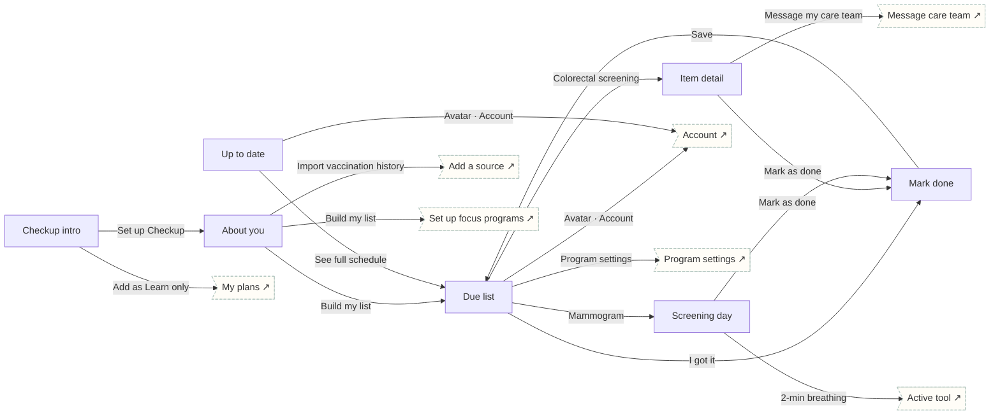

# Checkup

Preventive · Prevent. Personal due list from USPSTF/CDC guidance, item detail with options and cost, mark done, screening-day prep.

## Screens

| Screen | Route | Kind / state | Phase |
|---|---|---|---|
| [Checkup intro](../screens/png/ck/ck_intro.png) | `/p/ck` | screen | welcome |
| [About you](../screens/png/ck/ck_q1.png) | `/p/ck/onboarding/1` | screen | onboarding |
| [Due list](../screens/png/ck/ck_list.png) | `/p/ck/home` | screen | daily |
| [Up to date](../screens/png/ck/ck_uptodate.png) | `/p/ck/home?state=empty` | screen · empty | daily |
| [Item detail](../screens/png/ck/ck_item.png) | `/p/ck/item/:id` | screen | resources |
| [Mark done](../screens/png/ck/ck_done.png) | `/p/ck/done` | screen | milestone |
| [Screening day](../screens/png/ck/ck_day.png) | `/p/ck/day` | screen | milestone |

## Button & action map

| Screen | Element | Action |
|---|---|---|
| Checkup intro | Back | `back` |
| Checkup intro | Set up Checkup | `push → ck_q1` |
| Checkup intro | Add as Learn only | `toast “Checkup added as Learn only” then tab → plans` |
| About you | Back | `back` |
| About you | Import vaccination history | `push → records_add` |
| About you | Build my list | `PUT /v1/program-data/ck/profile then replace → ck_list (onboarding: ob_setup)` |
| Due list | Back | `back` |
| Due list | Avatar · Account | `push → account` |
| Due list | Find a pharmacy | `external https://www.vaccines.gov` |
| Due list | I got it | `push → ck_done` |
| Due list | Colorectal screening | `push → ck_item` |
| Due list | Mammogram | `push → ck_day` |
| Due list | Lung cancer screening | `push → ck_item` |
| Due list | Program settings | `push → program_settings` |
| Due list | Tab · Today | `tab → today` |
| Due list | Tab · Progress | `tab → progress` |
| Due list | Tab · Learn | `tab → learn` |
| Due list | Tab · Support | `tab → support` |
| Up to date | Back | `back` |
| Up to date | Avatar · Account | `push → account` |
| Up to date | See full schedule | `replace → ck_list` |
| Up to date | Tab · Today | `tab → today` |
| Up to date | Tab · Progress | `tab → progress` |
| Up to date | Tab · Learn | `tab → learn` |
| Up to date | Tab · Support | `tab → support` |
| Item detail | Back | `back` |
| Item detail | Message my care team | `push → support_message_care` |
| Item detail | Mark as done | `push → ck_done` |
| Mark done | Back | `back` |
| Mark done | Save | `POST /v1/program-data/ck/done then toast “Saved · next due Sep 2027” then replace → ck_list` |
| Screening day | Back | `back` |
| Screening day | 2-min breathing | `push → rescue_active` |
| Screening day | Add to calendar | `toast “Added to your calendar”` |
| Screening day | Mark as done | `push → ck_done` |
