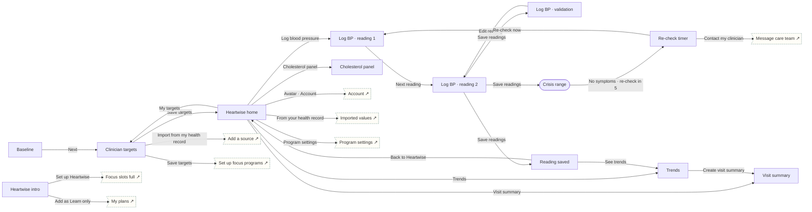

# Heartwise

Cardiovascular · Manage. Clinician targets, two-reading BP log, validation, symptom-gated crisis route, trends, lipid panel, previewed visit summary.

## Screens

| Screen | Route | Kind / state | Phase |
|---|---|---|---|
| [Heartwise intro](../screens/png/hw/hw_intro.png) | `/p/hw` | screen | welcome |
| [Baseline](../screens/png/hw/hw_q1.png) | `/p/hw/onboarding/1` | screen | onboarding |
| [Clinician targets](../screens/png/hw/hw_targets.png) | `/p/hw/plan/targets` | screen | plan |
| [Heartwise home](../screens/png/hw/hw_home.png) | `/p/hw/home` | screen | daily |
| [Log BP · reading 1](../screens/png/hw/hw_log.png) | `/p/hw/log` | screen | daily |
| [Log BP · reading 2](../screens/png/hw/hw_log2.png) | `/p/hw/log/2` | screen | daily |
| [Log BP · validation](../screens/png/hw/hw_log_error.png) | `/p/hw/log/2?state=error` | screen · error | daily |
| [Reading saved](../screens/png/hw/hw_result.png) | `/p/hw/log/result` | screen | daily |
| [Crisis range](../screens/png/hw/hw_crisis.png) | `/p/hw/crisis` | fullscreen | rescue |
| [Re-check timer](../screens/png/hw/hw_recheck.png) | `/p/hw/crisis/recheck` | screen | rescue |
| [Trends](../screens/png/hw/hw_trends.png) | `/p/hw/trends` | screen | resources |
| [Cholesterol panel](../screens/png/hw/hw_lipids.png) | `/p/hw/lipids` | screen | milestone |
| [Visit summary](../screens/png/hw/hw_summary.png) | `/p/hw/summary` | screen | resources |

## Button & action map

| Screen | Element | Action |
|---|---|---|
| Heartwise intro | Back | `back` |
| Heartwise intro | Set up Heartwise | `sheet → focus_full` |
| Heartwise intro | Add as Learn only | `toast “Heartwise added as Learn only” then tab → plans` |
| Baseline | Back | `back` |
| Baseline | Next | `push → hw_targets` |
| Clinician targets | Back | `back` |
| Clinician targets | Import from my health record | `push → records_add` |
| Clinician targets | Save targets | `PUT /v1/program-data/hw/targets then replace → hw_home (onboarding: ob_setup)` |
| Heartwise home | Back | `back` |
| Heartwise home | Avatar · Account | `push → account` |
| Heartwise home | Log blood pressure | `push → hw_log` |
| Heartwise home | Trends | `push → hw_trends` |
| Heartwise home | Cholesterol panel | `push → hw_lipids` |
| Heartwise home | Visit summary | `push → hw_summary` |
| Heartwise home | From your health record | `push → records_item` |
| Heartwise home | My targets | `push → hw_targets` |
| Heartwise home | Program settings | `push → program_settings` |
| Heartwise home | Call 911 | `call 911` |
| Heartwise home | Tab · Today | `tab → today` |
| Heartwise home | Tab · Progress | `tab → progress` |
| Heartwise home | Tab · Learn | `tab → learn` |
| Heartwise home | Tab · Support | `tab → support` |
| Log BP · reading 1 | Back | `back` |
| Log BP · reading 1 | Next reading | `push → hw_log2` |
| Log BP · reading 2 | Back | `back` |
| Log BP · reading 2 | Save readings | `POST /v1/program-data/hw/readings then decide hw.bp: Validated average → Valid · below crisis range: replace → hw_result | Invalid value: replace → hw_log_error | ≥180 top or ≥120 bottom: replace → hw_crisis` |
| Log BP · validation | Back | `back` |
| Log BP · validation | Save readings | `disabled` |
| Log BP · validation | Edit reading | `replace → hw_log2` |
| Reading saved | Close | `close` |
| Reading saved | See trends | `replace → hw_trends` |
| Reading saved | Back to Heartwise | `replace → hw_home` |
| Crisis range | Close | `close` |
| Crisis range | Yes · call 911 | `call 911` |
| Crisis range | No symptoms · re-check in 5 min | `replace → hw_recheck` |
| Re-check timer | Close | `close` |
| Re-check timer | Call 911 | `call 911` |
| Re-check timer | Re-check now | `replace → hw_log` |
| Re-check timer | Contact my clinician | `push → support_message_care` |
| Trends | Back | `back` |
| Trends | Create visit summary | `push → hw_summary` |
| Cholesterol panel | Back | `back` |
| Cholesterol panel | Save panel | `POST /v1/program-data/hw/lipids then toast “Panel saved” then back` |
| Visit summary | Back | `back` |
| Visit summary | Send summary | `POST /v1/care/summaries then toast “Summary sent to Dr. Patel’s clinic” then back` |
| Visit summary | Save as PDF | `toast “PDF saved to Files”` |
