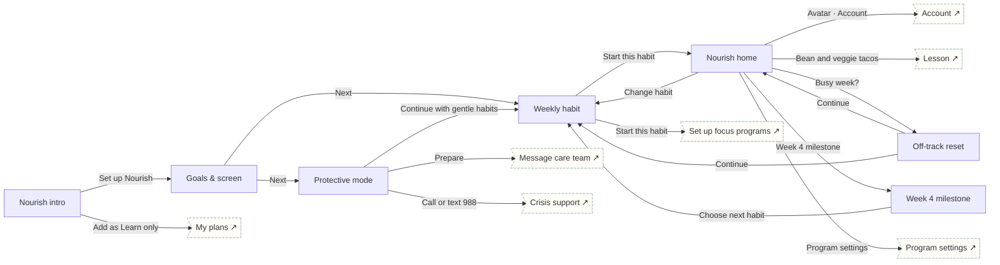

# Nourish

Obesity & nutrition · Build habits. Weight-neutral weekly habits, off-track reset, week-4 milestone, protective mode.

## Screens

| Screen | Route | Kind / state | Phase |
|---|---|---|---|
| [Nourish intro](../screens/png/nu/nu_intro.png) | `/p/nu` | screen | welcome |
| [Goals & screen](../screens/png/nu/nu_q1.png) | `/p/nu/onboarding/1` | screen | onboarding |
| [Weekly habit](../screens/png/nu/nu_habit.png) | `/p/nu/plan` | screen | plan |
| [Nourish home](../screens/png/nu/nu_home.png) | `/p/nu/home` | screen | daily |
| [Off-track reset](../screens/png/nu/nu_reset.png) | `/p/nu/reset` | screen | rescue |
| [Week 4 milestone](../screens/png/nu/nu_week4.png) | `/p/nu/milestone` | screen | milestone |
| [Protective mode](../screens/png/nu/nu_protect.png) | `/p/nu/support` | screen | rescue |

## Button & action map

| Screen | Element | Action |
|---|---|---|
| Nourish intro | Back | `back` |
| Nourish intro | Set up Nourish | `push → nu_q1` |
| Nourish intro | Add as Learn only | `toast “Nourish added as Learn only” then tab → plans` |
| Goals & screen | Back | `back` |
| Goals & screen | Next | `decide choice:nu_q1.eating: Eating-history answer → No: push → nu_habit | Yes / Prefer not to say: push → nu_protect` |
| Weekly habit | Back | `back` |
| Weekly habit | Start this habit | `PUT /v1/program-data/nu/habit then replace → nu_home (onboarding: ob_setup)` |
| Nourish home | Back | `back` |
| Nourish home | Avatar · Account | `push → account` |
| Nourish home | Done today | `toast “Nice. 4 of 5 nights.”` |
| Nourish home | Bean and veggie tacos | `push → learn_lesson` |
| Nourish home | Busy week? | `push → nu_reset` |
| Nourish home | Week 4 milestone | `push → nu_week4` |
| Nourish home | Change habit | `push → nu_habit` |
| Nourish home | Program settings | `push → program_settings` |
| Nourish home | Tab · Today | `tab → today` |
| Nourish home | Tab · Progress | `tab → progress` |
| Nourish home | Tab · Learn | `tab → learn` |
| Nourish home | Tab · Support | `tab → support` |
| Off-track reset | Back | `back` |
| Off-track reset | Continue | `decide choice:nu_reset.option: Selected option → Keep this habit: toast “Fresh start today” then replace → nu_home | Make it smaller: toast “Goal set to 3 nights” then replace → nu_home | Pick a different habit: replace → nu_habit` |
| Week 4 milestone | Back | `back` |
| Week 4 milestone | Choose next habit | `replace → nu_habit` |
| Protective mode | Back | `back` |
| Protective mode | Prepare | `push → support_message_care` |
| Protective mode | Call or text 988 | `push → crisis` |
| Protective mode | Call 911 | `call 911` |
| Protective mode | Continue with gentle habits | `replace → nu_habit (onboarding: nu_habit)` |
