# First run

Welcome → choose programs → focus → consent → basics → set up each focus program → reminders → save progress → Today.

```mermaid
flowchart LR
  welcome["Welcome"]
  ob_programs["Choose programs"]
  ob_focus["Focus slots"]
  ob_third{{"Third program sheet"}}
  ob_consent["Layered consent"]
  ob_basics["Shared basics"]
  ob_setup["Set up focus programs"]
  ob_reminders["Reminder prime"]
  ob_reminders_denied["Reminders denied"]
  ob_account["Save your progress"]
  welcome -->|"Get started"| ob_programs
  welcome -->|"I already have an account"| auth_signin
  ob_programs -->|"See all 11 programs"| catalog
  ob_programs -->|"Continue with 2 programs"| ob_focus
  ob_focus -->|"Add a third program"| ob_third
  ob_focus -->|"Continue"| ob_consent
  ob_consent -->|"Agree and continue"| ob_basics
  ob_basics -->|"Continue"| ob_setup
  ob_setup -->|"BreatheFree"| bf_q1
  ob_setup -->|"ScrollFree"| sf_q1
  ob_setup -->|"Health records (optional)"| records_add
  ob_setup -->|"Continue"| ob_reminders
  ob_reminders -->|"Turn on reminders"| ob_account
  ob_reminders -->|"Turn on reminders"| ob_reminders_denied
  ob_reminders_denied -->|"Continue without reminders"| ob_account
  ob_account -->|"Continue with Apple"| auth_merge
  ob_account -->|"Continue with Apple"| auth_link
  ob_account -->|"Continue with Apple"| auth_social_error
  ob_account -->|"Create account"| auth_verify
  ob_account -->|"Continue on this phone only"| today
  auth_link>"Link accounts ↗"]
  class auth_link ext
  auth_merge>"Guest plan merge ↗"]
  class auth_merge ext
  auth_signin>"Sign in ↗"]
  class auth_signin ext
  auth_social_error>"Apple / Google sign-in failed ↗"]
  class auth_social_error ext
  auth_verify>"Verify email ↗"]
  class auth_verify ext
  bf_q1>"Baseline: amount ↗"]
  class bf_q1 ext
  catalog>"Add a program ↗"]
  class catalog ext
  records_add>"Add a source ↗"]
  class records_add ext
  sf_q1>"Baseline: use ↗"]
  class sf_q1 ext
  today>"Today ↗"]
  class today ext
  classDef ext fill:#FFFDF7,stroke:#B6C8C2,stroke-dasharray: 4 3
```

## Screens

| Screen | Route | Kind / state | Phase |
|---|---|---|---|
| [Welcome](../screens/png/onboarding/welcome.png) | `/welcome` | screen | welcome |
| [Choose programs](../screens/png/onboarding/ob_programs.png) | `/onboarding/programs` | screen | welcome |
| [Focus slots](../screens/png/onboarding/ob_focus.png) | `/onboarding/focus` | screen | welcome |
| [Third program sheet](../screens/png/onboarding/ob_third.png) | `/onboarding/focus/third` | sheet | welcome |
| [Layered consent](../screens/png/onboarding/ob_consent.png) | `/onboarding/consent` | screen | onboarding |
| [Shared basics](../screens/png/onboarding/ob_basics.png) | `/onboarding/basics` | screen | onboarding |
| [Set up focus programs](../screens/png/onboarding/ob_setup.png) | `/onboarding/setup` | screen | onboarding |
| [Reminder prime](../screens/png/onboarding/ob_reminders.png) | `/onboarding/reminders` | screen | onboarding |
| [Reminders denied](../screens/png/onboarding/ob_reminders_denied.png) | `/onboarding/reminders?state=denied` | screen · permission denied | onboarding |
| [Save your progress](../screens/png/onboarding/ob_account.png) | `/onboarding/account` | screen | account |

## Button & action map

| Screen | Element | Action |
|---|---|---|
| Welcome | Get started | `push → ob_programs` |
| Welcome | I already have an account | `sheet → auth_signin` |
| Welcome | Terms and Privacy Notice | `external https://www.tetherhealthgroup.com/privacy/` |
| Choose programs | Back | `back` |
| Choose programs | See all 11 programs | `push → catalog` |
| Choose programs | Continue with 2 programs | `push → ob_focus` |
| Focus slots | Back | `back` |
| Focus slots | Add a third program | `sheet → ob_third` |
| Focus slots | Continue | `push → ob_consent` |
| Third program sheet | Continue | `toast “Heartwise added as Learn only” then close` |
| Third program sheet | Cancel | `close` |
| Layered consent | Back | `back` |
| Layered consent | Read the Privacy Notice | `external https://www.tetherhealthgroup.com/privacy/` |
| Layered consent | Agree and continue | `POST /v1/enrolments/consents then push → ob_basics` |
| Shared basics | Back | `back` |
| Shared basics | Continue | `push → ob_setup` |
| Set up focus programs | Back | `back` |
| Set up focus programs | BreatheFree | `push → bf_q1` |
| Set up focus programs | ScrollFree | `push → sf_q1` |
| Set up focus programs | Health records (optional) | `push → records_add` |
| Set up focus programs | Continue | `push → ob_reminders` |
| Set up focus programs | Set up later | `push → ob_reminders` |
| Reminder prime | Back | `back` |
| Reminder prime | Turn on reminders | `branch: System permission prompt → Allowed: push → ob_account | Not allowed: push → ob_reminders_denied` |
| Reminder prime | Not now | `push → ob_account` |
| Reminders denied | Back | `back` |
| Reminders denied | Open phone settings | `os_settings` |
| Reminders denied | Continue without reminders | `push → ob_account` |
| Save your progress | Close | `close` |
| Save your progress | Continue with Apple | `auth (apple): Sign in with Apple result → Success: push → auth_merge | Email already has a Tether account: push → auth_link | Cancelled: toast “Sign-in cancelled” | Error: push → auth_social_error` |
| Save your progress | Continue with Google | `auth (google): Sign in with Google result → Success: push → auth_merge | Email already has a Tether account: push → auth_link | Cancelled: toast “Sign-in cancelled” | Error: push → auth_social_error` |
| Save your progress | Create account | `POST supabase /auth/v1/signup then push → auth_verify` |
| Save your progress | Continue on this phone only | `reset → today` |
