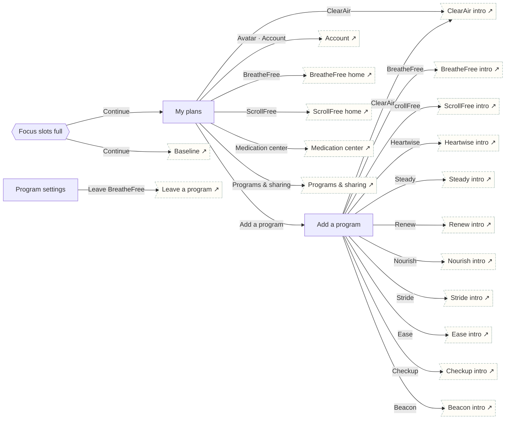

# Plans & programs

My plans hub, program catalog (the 11 programs from tetherhealthgroup.com), focus-slot rules and per-program settings.

## Screens

| Screen | Route | Kind / state | Phase |
|---|---|---|---|
| [My plans](../screens/png/plans/plans.png) | `/plans` | screen | plan |
| [Add a program](../screens/png/plans/catalog.png) | `/programs` | screen | welcome |
| [Focus slots full](../screens/png/plans/focus_full.png) | `/programs/focus-full` | sheet | plan |
| [Program settings](../screens/png/plans/program_settings.png) | `/p/:program/settings` | screen | account |

## Button & action map

| Screen | Element | Action |
|---|---|---|
| My plans | Avatar · Account | `push → account` |
| My plans | BreatheFree | `push → bf_home` |
| My plans | ScrollFree | `push → sf_home` |
| My plans | ClearAir | `push → ca_intro` |
| My plans | Medication center | `push → bf_meds` |
| My plans | Programs & sharing | `push → account_programs` |
| My plans | Add a program | `push → catalog` |
| My plans | Tab · Today | `tab → today` |
| My plans | Tab · Progress | `tab → progress` |
| My plans | Tab · Learn | `tab → learn` |
| My plans | Tab · Support | `tab → support` |
| Add a program | Back | `back` |
| Add a program | BreatheFree | `push → bf_intro` |
| Add a program | ScrollFree | `push → sf_intro` |
| Add a program | ClearAir | `push → ca_intro` |
| Add a program | Heartwise | `push → hw_intro` |
| Add a program | Steady | `push → st_intro` |
| Add a program | Renew | `push → re_intro` |
| Add a program | Nourish | `push → nu_intro` |
| Add a program | Stride | `push → sd_intro` |
| Add a program | Ease | `push → ea_intro` |
| Add a program | Checkup | `push → ck_intro` |
| Add a program | Beacon | `push → be_intro` |
| Focus slots full | Continue | `decide choice:focus_full.option: Chosen option → Learn only: toast “Heartwise added as Learn only” then tab → plans | Swap: replace → hw_q1` |
| Focus slots full | Cancel | `close` |
| Program settings | Back | `back` |
| Program settings | Export BreatheFree data | `toast “Export is being prepared. We’ll notify you.”` |
| Program settings | Leave BreatheFree | `sheet → account_leave` |
| Program settings | Save changes | `PATCH /v1/enrolments/:id then toast “Saved” then back` |
