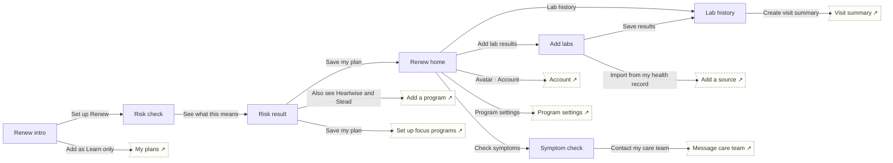

# Renew

Kidney & liver · Manage. Risk check, plain-language result, labs and trends, reminders, warning-symptom route.

## Screens

| Screen | Route | Kind / state | Phase |
|---|---|---|---|
| [Renew intro](../screens/png/re/re_intro.png) | `/p/re` | screen | welcome |
| [Risk check](../screens/png/re/re_q1.png) | `/p/re/onboarding/1` | screen | onboarding |
| [Risk result](../screens/png/re/re_result.png) | `/p/re/plan` | screen | plan |
| [Renew home](../screens/png/re/re_home.png) | `/p/re/home` | screen | daily |
| [Add labs](../screens/png/re/re_labs.png) | `/p/re/labs` | screen | milestone |
| [Lab history](../screens/png/re/re_history.png) | `/p/re/history` | screen | resources |
| [Symptom check](../screens/png/re/re_symptoms.png) | `/p/re/symptoms` | screen | rescue |

## Button & action map

| Screen | Element | Action |
|---|---|---|
| Renew intro | Back | `back` |
| Renew intro | Set up Renew | `push → re_q1` |
| Renew intro | Add as Learn only | `toast “Renew added as Learn only” then tab → plans` |
| Risk check | Back | `back` |
| Risk check | See what this means | `push → re_result` |
| Risk result | Back | `back` |
| Risk result | Also see Heartwise and Steady | `push → catalog` |
| Risk result | Save my plan | `PUT /v1/program-data/re/plan then replace → re_home (onboarding: ob_setup)` |
| Renew home | Back | `back` |
| Renew home | Avatar · Account | `push → account` |
| Renew home | Add lab results | `push → re_labs` |
| Renew home | Lab history | `push → re_history` |
| Renew home | Check symptoms | `push → re_symptoms` |
| Renew home | Program settings | `push → program_settings` |
| Renew home | Tab · Today | `tab → today` |
| Renew home | Tab · Progress | `tab → progress` |
| Renew home | Tab · Learn | `tab → learn` |
| Renew home | Tab · Support | `tab → support` |
| Add labs | Back | `back` |
| Add labs | Import from my health record | `push → records_add` |
| Add labs | Save results | `POST /v1/program-data/re/labs then toast “Saved” then replace → re_history` |
| Lab history | Back | `back` |
| Lab history | Create visit summary | `push → hw_summary` |
| Symptom check | Close | `close` |
| Symptom check | Contact my care team | `push → support_message_care` |
| Symptom check | Vomiting blood or confused? Call 911 | `call 911` |
