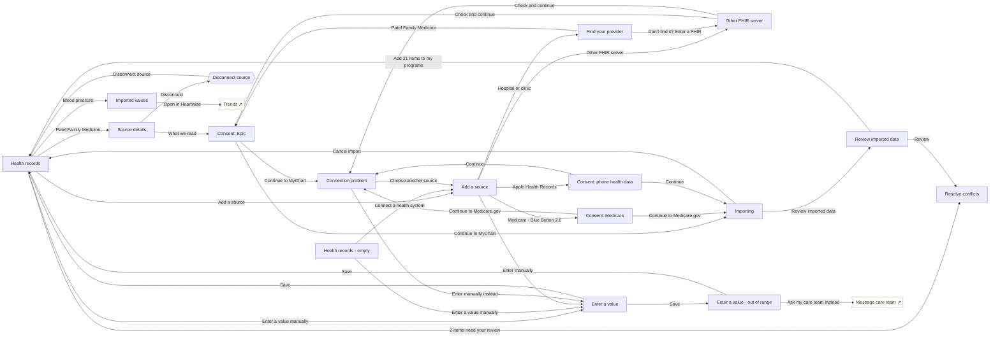

# Health records (FHIR & manual)

Connect Epic MyChart, Oracle Health, Medicare Blue Button 2.0, Apple Health Records / Health Connect or any SMART on FHIR R4 server, or enter values by hand. Every value is validated (units, plausibility, duplicates, conflicts) and reviewed before it reaches a program.

## Screens

| Screen | Route | Kind / state | Phase |
|---|---|---|---|
| [Health records](../screens/png/records/records_hub.png) | `/records` | screen | resources |
| [Health records · empty](../screens/png/records/records_hub_empty.png) | `/records?state=empty` | screen · empty | resources |
| [Add a source](../screens/png/records/records_add.png) | `/records/add` | screen | resources |
| [Find your provider](../screens/png/records/records_search.png) | `/records/search` | screen | resources |
| [Other FHIR server](../screens/png/records/records_fhir_url.png) | `/records/fhir-url` | screen | resources |
| [Consent: Epic](../screens/png/records/records_consent.png) | `/records/consent` | screen | resources |
| [Consent: Medicare](../screens/png/records/records_consent_bb.png) | `/records/consent?source=medicare` | screen · Medicare | resources |
| [Consent: phone health data](../screens/png/records/records_consent_device.png) | `/records/consent?source=device` | screen · Apple Health / Health Connect | resources |
| [Importing](../screens/png/records/records_importing.png) | `/records/importing` | screen | resources |
| [Review imported data](../screens/png/records/records_review.png) | `/records/review` | screen | resources |
| [Resolve conflicts](../screens/png/records/records_conflict.png) | `/records/conflicts` | screen | resources |
| [Connection problem](../screens/png/records/records_error.png) | `/records/error` | screen | resources |
| [Source details](../screens/png/records/records_source.png) | `/records/source` | screen | resources |
| [Disconnect source](../screens/png/records/records_disconnect.png) | `/records/source/disconnect` | sheet | resources |
| [Enter a value](../screens/png/records/records_manual.png) | `/records/manual` | screen | resources |
| [Enter a value · out of range](../screens/png/records/records_manual_error.png) | `/records/manual?state=error` | screen · error | resources |
| [Imported values](../screens/png/records/records_item.png) | `/records/item` | screen | resources |

## Button & action map

| Screen | Element | Action |
|---|---|---|
| Health records | Back | `back` |
| Health records | Patel Family Medicine | `push → records_source` |
| Health records | Medicare | `push → records_source` |
| Health records | Blood pressure | `push → records_item` |
| Health records | Lab results | `push → records_item` |
| Health records | Immunizations | `push → records_item` |
| Health records | Smoking status | `push → records_item` |
| Health records | Medications & conditions | `push → records_item` |
| Health records | 2 items need your review | `push → records_conflict` |
| Health records | Add a source | `push → records_add` |
| Health records | Enter a value manually | `push → records_manual` |
| Health records · empty | Back | `back` |
| Health records · empty | Connect a health system | `push → records_add` |
| Health records · empty | Enter a value manually | `push → records_manual` |
| Add a source | Back | `back` |
| Add a source | Hospital or clinic | `push → records_search` |
| Add a source | Oracle Health (Cerner) | `push → records_search` |
| Add a source | Medicare · Blue Button 2.0 | `push → records_consent_bb` |
| Add a source | Apple Health Records | `push → records_consent_device` |
| Add a source | Health Connect | `push → records_consent_device` |
| Add a source | Other FHIR server | `push → records_fhir_url` |
| Add a source | Enter manually | `push → records_manual` |
| Find your provider | Back | `back` |
| Find your provider | Patel Family Medicine | `push → records_consent` |
| Find your provider | Patel Heart Institute | `push → records_consent` |
| Find your provider | Stanford Health Care | `push → records_consent` |
| Find your provider | Can’t find it? Enter a FHIR address | `push → records_fhir_url` |
| Other FHIR server | Back | `back` |
| Other FHIR server | Check and continue | `branch: Server check → SMART on FHIR R4 supported: push → records_consent | Not a FHIR R4 server: push → records_error` |
| Consent: Epic | Back | `back` |
| Consent: Epic | Continue to MyChart | `branch: MyChart sign-in result → Approved: push → records_importing | Cancelled: toast “Connection cancelled. Nothing was imported.” | Denied or error: push → records_error` |
| Consent: Epic | Not now | `back` |
| Consent: Medicare | Back | `back` |
| Consent: Medicare | Continue to Medicare.gov | `branch: Medicare sign-in result → Approved: push → records_importing | Cancelled: toast “Connection cancelled. Nothing was imported.” | Denied or error: push → records_error` |
| Consent: Medicare | Not now | `back` |
| Consent: phone health data | Back | `back` |
| Consent: phone health data | Continue | `branch: System permission result → Allowed: push → records_importing | Not allowed: push → records_error` |
| Consent: phone health data | Not now | `back` |
| Importing | Close | `close` |
| Importing | Review imported data | `replace → records_review` |
| Importing | Cancel import | `popto → records_hub` |
| Review imported data | Close | `close` |
| Review imported data | Review | `push → records_conflict` |
| Review imported data | Add 21 items to my programs | `POST /v1/records/fhir/accept then toast “Added to Heartwise, Steady, Checkup, BreatheFree and Renew” then popto → records_hub` |
| Review imported data | Review conflicts first | `push → records_conflict` |
| Resolve conflicts | Back | `back` |
| Resolve conflicts | Save choices | `POST /v1/records/fhir/conflicts then toast “Saved” then back` |
| Connection problem | Back | `back` |
| Connection problem | Try again | `back` |
| Connection problem | Choose another source | `replace → records_add` |
| Connection problem | Enter manually instead | `replace → records_manual` |
| Source details | Back | `back` |
| Source details | Sync now | `POST /v1/records/fhir/sources/:id/sync then toast “Synced · 2 new results”` |
| Source details | What we read | `push → records_consent` |
| Source details | Disconnect | `sheet → records_disconnect` |
| Disconnect source | Disconnect source | `DELETE /v1/records/fhir/sources/:id then toast “Disconnected” then popto → records_hub` |
| Disconnect source | Cancel | `close` |
| Enter a value | Back | `back` |
| Enter a value | Save | `POST /v1/records/manual then decide rec.manual: Validation → Valid: toast “Saved · shared with Steady” then popto → records_hub | Outside expected range: replace → records_manual_error | Matches an imported value: toast “Already in your records from Epic. Not added twice.” then back` |
| Enter a value · out of range | Back | `back` |
| Enter a value · out of range | Save | `POST /v1/records/manual then decide rec.manual: Validation → Valid: toast “Saved · shared with Steady” then popto → records_hub | Outside expected range: toast “Still outside the expected range”` |
| Enter a value · out of range | Ask my care team instead | `push → support_message_care` |
| Imported values | Back | `back` |
| Imported values | Open in Heartwise | `push → hw_trends` |
