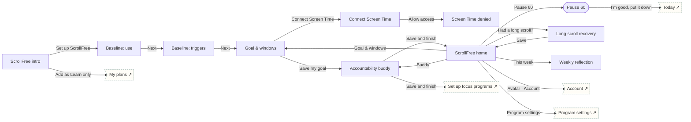

# ScrollFree

Social media use · Quit / Reduce. Self-report first, minute goal + app-free windows, Pause 60, buddy, weekly reflection.

## Screens

| Screen | Route | Kind / state | Phase |
|---|---|---|---|
| [ScrollFree intro](../screens/png/sf/sf_intro.png) | `/p/sf` | screen | welcome |
| [Baseline: use](../screens/png/sf/sf_q1.png) | `/p/sf/onboarding/1` | screen | onboarding |
| [Baseline: triggers](../screens/png/sf/sf_q2.png) | `/p/sf/onboarding/2` | screen | onboarding |
| [Goal & windows](../screens/png/sf/sf_goal.png) | `/p/sf/plan/goal` | screen | plan |
| [Connect Screen Time](../screens/png/sf/sf_screentime.png) | `/p/sf/screen-time` | screen | plan |
| [Screen Time denied](../screens/png/sf/sf_screentime_denied.png) | `/p/sf/screen-time?state=denied` | screen · permission denied | plan |
| [Accountability buddy](../screens/png/sf/sf_buddy.png) | `/p/sf/plan/buddy` | screen | plan |
| [ScrollFree home](../screens/png/sf/sf_home.png) | `/p/sf/home` | screen | daily |
| [Pause 60](../screens/png/sf/sf_pause.png) | `/p/sf/pause` | fullscreen | rescue |
| [Long-scroll recovery](../screens/png/sf/sf_slip.png) | `/p/sf/slip` | screen | milestone |
| [Weekly reflection](../screens/png/sf/sf_week.png) | `/p/sf/week` | screen | milestone |

## Button & action map

| Screen | Element | Action |
|---|---|---|
| ScrollFree intro | Back | `back` |
| ScrollFree intro | Set up ScrollFree | `push → sf_q1` |
| ScrollFree intro | Add as Learn only | `toast “ScrollFree added as Learn only” then tab → plans` |
| Baseline: use | Back | `back` |
| Baseline: use | Next | `push → sf_q2` |
| Baseline: triggers | Back | `back` |
| Baseline: triggers | Next | `push → sf_goal` |
| Goal & windows | Back | `back` |
| Goal & windows | Connect Screen Time | `push → sf_screentime` |
| Goal & windows | Save my goal | `push → sf_buddy` |
| Connect Screen Time | Back | `back` |
| Connect Screen Time | Allow access | `branch: iOS Screen Time permission → Allowed: toast “Screen Time connected” then back | Not allowed: replace → sf_screentime_denied` |
| Connect Screen Time | Not now | `back` |
| Screen Time denied | Back | `back` |
| Screen Time denied | Continue with self-report | `back` |
| Screen Time denied | Open phone settings | `os_settings` |
| Accountability buddy | Back | `back` |
| Accountability buddy | Save and finish | `PUT /v1/program-data/sf/plan then replace → sf_home (onboarding: ob_setup)` |
| Accountability buddy | Skip for now | `replace → sf_home (onboarding: ob_setup)` |
| ScrollFree home | Back | `back` |
| ScrollFree home | Avatar · Account | `push → account` |
| ScrollFree home | Pause 60 | `push → sf_pause` |
| ScrollFree home | This week | `push → sf_week` |
| ScrollFree home | Had a long scroll? | `push → sf_slip` |
| ScrollFree home | Goal & windows | `push → sf_goal` |
| ScrollFree home | Buddy | `push → sf_buddy` |
| ScrollFree home | Program settings | `push → program_settings` |
| ScrollFree home | Tab · Today | `tab → today` |
| ScrollFree home | Tab · Progress | `tab → progress` |
| ScrollFree home | Tab · Learn | `tab → learn` |
| ScrollFree home | Tab · Support | `tab → support` |
| Pause 60 | Close | `close` |
| Pause 60 | I’m good, put it down | `POST /v1/program-data/sf/pauses then toast “Nice. Logged as a pause.” then reset → today` |
| Pause 60 | Open anyway (logged as information) | `toast “Logged. No judgment.” then close` |
| Long-scroll recovery | Back | `back` |
| Long-scroll recovery | Save | `POST /v1/records/lapses then toast “Saved” then replace → sf_home` |
| Weekly reflection | Back | `back` |
| Weekly reflection | Yes | `toast “Goal set to 75 min” then back` |
| Weekly reflection | Stay at 90 | `back` |
