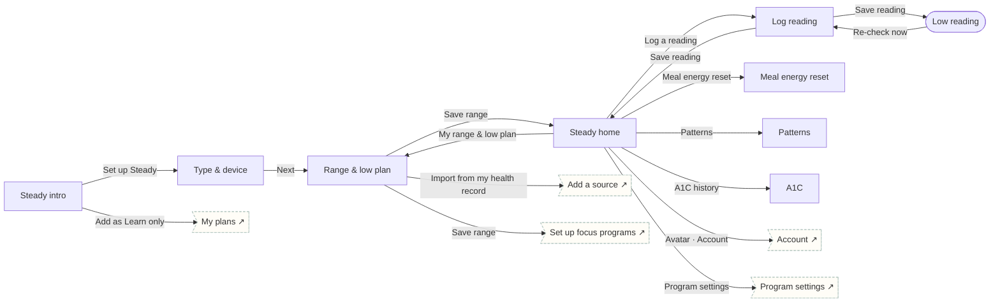

# Steady

Diabetes & metabolic · Manage. Clinician range + own low plan, reading log, low route with 15-min timer, meal reset, patterns, A1C.

## Screens

| Screen | Route | Kind / state | Phase |
|---|---|---|---|
| [Steady intro](../screens/png/st/st_intro.png) | `/p/st` | screen | welcome |
| [Type & device](../screens/png/st/st_q1.png) | `/p/st/onboarding/1` | screen | onboarding |
| [Range & low plan](../screens/png/st/st_range.png) | `/p/st/plan/range` | screen | plan |
| [Steady home](../screens/png/st/st_home.png) | `/p/st/home` | screen | daily |
| [Log reading](../screens/png/st/st_log.png) | `/p/st/log` | screen | daily |
| [Low reading](../screens/png/st/st_low.png) | `/p/st/low` | fullscreen | rescue |
| [Meal energy reset](../screens/png/st/st_reset.png) | `/p/st/reset` | screen | daily |
| [Patterns](../screens/png/st/st_patterns.png) | `/p/st/patterns` | screen | resources |
| [A1C](../screens/png/st/st_a1c.png) | `/p/st/a1c` | screen | milestone |

## Button & action map

| Screen | Element | Action |
|---|---|---|
| Steady intro | Back | `back` |
| Steady intro | Set up Steady | `push → st_q1` |
| Steady intro | Add as Learn only | `toast “Steady added as Learn only” then tab → plans` |
| Type & device | Back | `back` |
| Type & device | Next | `push → st_range` |
| Range & low plan | Back | `back` |
| Range & low plan | Import from my health record | `push → records_add` |
| Range & low plan | Save range | `PUT /v1/program-data/st/range then replace → st_home (onboarding: ob_setup)` |
| Steady home | Back | `back` |
| Steady home | Avatar · Account | `push → account` |
| Steady home | Log a reading | `push → st_log` |
| Steady home | Meal energy reset | `push → st_reset` |
| Steady home | Patterns | `push → st_patterns` |
| Steady home | A1C history | `push → st_a1c` |
| Steady home | My range & low plan | `push → st_range` |
| Steady home | Program settings | `push → program_settings` |
| Steady home | Tab · Today | `tab → today` |
| Steady home | Tab · Progress | `tab → progress` |
| Steady home | Tab · Learn | `tab → learn` |
| Steady home | Tab · Support | `tab → support` |
| Log reading | Back | `back` |
| Log reading | Save reading | `POST /v1/program-data/st/readings then decide st.glucose: Reading vs. your range → In or above range: toast “Saved” then replace → st_home | Below your low: replace → st_low | Invalid (outside 20–600): toast “Check your meter reading”` |
| Low reading | Close | `close` |
| Low reading | Call 911 | `call 911` |
| Low reading | Re-check now | `replace → st_log` |
| Meal energy reset | Back | `back` |
| Meal energy reset | Done | `toast “Nice work” then back` |
| Patterns | Back | `back` |
| A1C | Back | `back` |
| A1C | Save | `POST /v1/program-data/st/a1c then toast “Saved” then back` |
