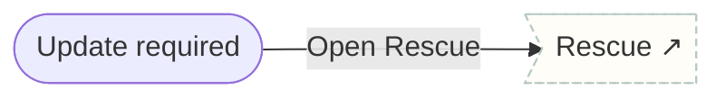

# System states

App-wide events: forced update.

## Screens

| Screen | Route | Kind / state | Phase |
|---|---|---|---|
| [Update required](../screens/png/system/sys_update.png) | `/system/update` | fullscreen | account |

## Button & action map

| Screen | Element | Action |
|---|---|---|
| Update required | Update now | `external https://apps.apple.com/app/tether-health` |
| Update required | Open Rescue | `sheet → rescue_pick` |
