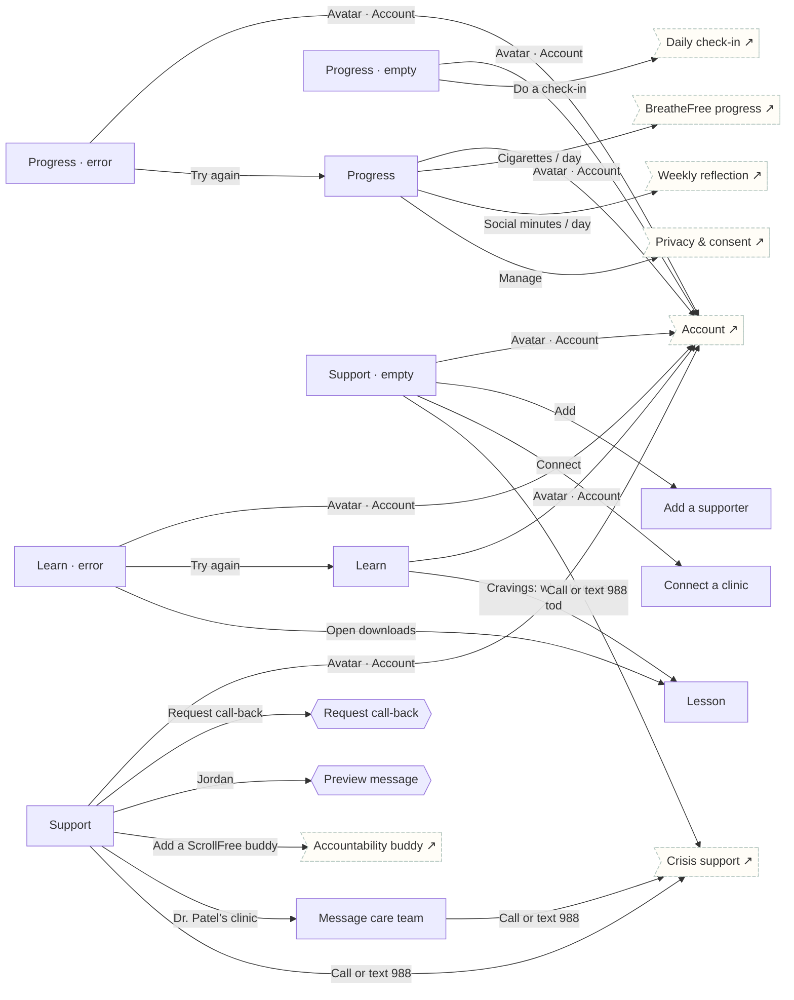

# Progress, Learn & Support

Shared tabs that read every enrolment.

## Screens

| Screen | Route | Kind / state | Phase |
|---|---|---|---|
| [Progress](../screens/png/tabs/progress.png) | `/progress` | screen | resources |
| [Progress · empty](../screens/png/tabs/progress_empty.png) | `/progress?state=empty` | screen · empty | resources |
| [Progress · error](../screens/png/tabs/progress_error.png) | `/progress?state=error` | screen · error | resources |
| [Learn](../screens/png/tabs/learn.png) | `/learn` | screen | resources |
| [Learn · error](../screens/png/tabs/learn_error.png) | `/learn?state=error` | screen · error | resources |
| [Lesson](../screens/png/tabs/learn_lesson.png) | `/learn/:lesson` | screen | resources |
| [Support](../screens/png/tabs/support.png) | `/support` | screen | resources |
| [Support · empty](../screens/png/tabs/support_empty.png) | `/support?state=empty` | screen · empty | resources |
| [Request call-back](../screens/png/tabs/support_callback.png) | `/support/callback` | sheet | resources |
| [Preview message](../screens/png/tabs/support_message.png) | `/support/message` | sheet | resources |
| [Message care team](../screens/png/tabs/support_message_care.png) | `/support/care-team` | screen | resources |
| [Add a supporter](../screens/png/tabs/support_add_person.png) | `/support/people/new` | screen | resources |
| [Connect a clinic](../screens/png/tabs/support_connect.png) | `/support/connect` | screen | resources |

## Button & action map

| Screen | Element | Action |
|---|---|---|
| Progress | Avatar · Account | `push → account` |
| Progress | Cigarettes / day | `push → bf_progress` |
| Progress | Social minutes / day | `push → sf_week` |
| Progress | Manage | `push → account_privacy` |
| Progress | Tab · Today | `tab → today` |
| Progress | Tab · Plans | `tab → plans` |
| Progress | Tab · Learn | `tab → learn` |
| Progress | Tab · Support | `tab → support` |
| Progress · empty | Avatar · Account | `push → account` |
| Progress · empty | Do a check-in | `sheet → checkin` |
| Progress · empty | Tab · Today | `tab → today` |
| Progress · empty | Tab · Plans | `tab → plans` |
| Progress · empty | Tab · Learn | `tab → learn` |
| Progress · empty | Tab · Support | `tab → support` |
| Progress · error | Avatar · Account | `push → account` |
| Progress · error | Try again | `replace → progress` |
| Progress · error | Tab · Today | `tab → today` |
| Progress · error | Tab · Plans | `tab → plans` |
| Progress · error | Tab · Learn | `tab → learn` |
| Progress · error | Tab · Support | `tab → support` |
| Learn | Avatar · Account | `push → account` |
| Learn | Cravings: what to expect today | `push → learn_lesson` |
| Learn | Why “one more video” never feels like enough | `push → learn_lesson` |
| Learn | How your lungs recover after you quit | `push → learn_lesson` |
| Learn | Tab · Today | `tab → today` |
| Learn | Tab · Plans | `tab → plans` |
| Learn | Tab · Progress | `tab → progress` |
| Learn | Tab · Support | `tab → support` |
| Learn · error | Avatar · Account | `push → account` |
| Learn · error | Try again | `replace → learn` |
| Learn · error | Open downloads | `push → learn_lesson` |
| Learn · error | Tab · Today | `tab → today` |
| Learn · error | Tab · Plans | `tab → plans` |
| Learn · error | Tab · Progress | `tab → progress` |
| Learn · error | Tab · Support | `tab → support` |
| Lesson | Back | `back` |
| Lesson | Play | `toast “Playing audio”` |
| Lesson | Transcript | `toast “Transcript opened”` |
| Lesson | Mark complete | `POST /v1/records/lessons then toast “Lesson complete” then back` |
| Lesson | Save for offline | `toast “Saved for offline”` |
| Support | Avatar · Account | `push → account` |
| Support | Call now | `call 1-800-784-8669` |
| Support | Request call-back | `sheet → support_callback` |
| Support | Jordan | `sheet → support_message` |
| Support | Add a ScrollFree buddy | `push → sf_buddy` |
| Support | Dr. Patel’s clinic | `push → support_message_care` |
| Support | Call or text 988 | `push → crisis` |
| Support | Call 911 | `call 911` |
| Support | Tab · Today | `tab → today` |
| Support | Tab · Plans | `tab → plans` |
| Support | Tab · Progress | `tab → progress` |
| Support | Tab · Learn | `tab → learn` |
| Support · empty | Avatar · Account | `push → account` |
| Support · empty | Call | `call 1-800-784-8669` |
| Support · empty | Add | `push → support_add_person` |
| Support · empty | Connect | `push → support_connect` |
| Support · empty | Call or text 988 | `push → crisis` |
| Support · empty | Call 911 | `call 911` |
| Support · empty | Tab · Today | `tab → today` |
| Support · empty | Tab · Plans | `tab → plans` |
| Support · empty | Tab · Progress | `tab → progress` |
| Support · empty | Tab · Learn | `tab → learn` |
| Request call-back | Send referral | `POST /v1/care/referrals then toast “Request sent. Expect a call within 2 business days.” then close` |
| Request call-back | Cancel | `close` |
| Preview message | Open Messages | `sms Jordan` |
| Preview message | Cancel | `close` |
| Message care team | Back | `back` |
| Message care team | Call or text 988 | `push → crisis` |
| Message care team | Call 911 | `call 911` |
| Message care team | Send message | `POST /v1/care/messages then toast “Message sent” then back` |
| Add a supporter | Back | `back` |
| Add a supporter | Save supporter | `POST /v1/care/supporters then toast “Jordan added” then back` |
| Connect a clinic | Back | `back` |
| Connect a clinic | Connect | `POST /v1/care/connections then toast “Connected to Dr. Patel’s clinic” then back` |
